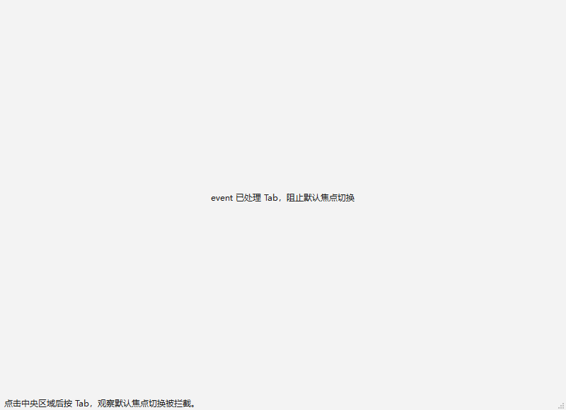

# 10.3 event中拦截Tab

[所属章节](../chapters/10-events.md) · [完整项目](../../examples/10_03_event_tab/README.md)

### 本项目要掌握什么

event中拦截Tab。这一节只围绕这个核心问题阅读和修改程序。

### 关键代码在哪里

关键片段 1：[ eventarea.cpp 第 15 行起](../../examples/10_03_event_tab/eventarea.cpp#L15)。以下代码从本项目源文件提取，完整上下文见源文件。

```cpp
bool EventArea::event(QEvent *event)
{
    if (event->type() == QEvent::KeyPress)
    {
        auto *key = static_cast<QKeyEvent *>(event);
        if (key->key() == Qt::Key_Tab)
        {
            setText("event 已处理 Tab，阻止默认焦点切换");
            return true;
        }
    }
    return QLabel::event(event);
}
```

### 逐段讲解

event 先判断 QEvent::KeyPress，再将指针转换为 QKeyEvent 并检查 Tab；识别后返回 true 表示本次已处理。

其余情况调用 QLabel::event，保留默认事件分发。Tab 常参与焦点切换，需要在这里理解分发与特定处理函数的关系。

### 按执行顺序阅读

窗口初始化先准备对象和连接；用户输入、尺寸变化或重绘请求到达后，才进入上述处理函数。依次追踪事件或信号的目标、类型判断、状态变化和结果更新，再观察是否把剩余处理交回基类。

### 容易出错的地方与动手验证

比较返回 true 与调用基类后的焦点行为；不要不判断类型就 static_cast，也不要无条件吞掉所有事件。

先写下预测，再修改一个条件重新构建。记录实际结果，并用本节代码中的变量、对象和调用顺序解释原因；仅仅没有报错不代表已经验证了所有分支。

### 运行结果



### 完整项目与界面文件

- [10_03_event_tab.pro](../../examples/10_03_event_tab/10_03_event_tab.pro)
- [eventarea.cpp](../../examples/10_03_event_tab/eventarea.cpp)
- [eventarea.h](../../examples/10_03_event_tab/eventarea.h)
- [main.cpp](../../examples/10_03_event_tab/main.cpp)
- [mainwindow.cpp](../../examples/10_03_event_tab/mainwindow.cpp)
- [mainwindow.h](../../examples/10_03_event_tab/mainwindow.h)
- [mainwindow.ui](../../examples/10_03_event_tab/mainwindow.ui)
- [verify.h](../../examples/10_03_event_tab/verify.h)

打开本项目 .pro，选择匹配的 Kit，构建运行；修改界面请打开 .ui，保存后重新构建。verify.h 只在传入 --verify 时执行检查。
