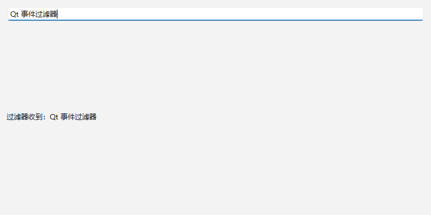

# 10.4 为现有控件安装事件过滤器

[所属章节](../chapters/10-events.md) · [完整项目](../../examples/10_04_event_filter/README.md)

### 本项目要掌握什么

为现有控件安装事件过滤器。这一节只围绕这个核心问题阅读和修改程序。

### 关键代码在哪里

关键片段 1：[ widget.cpp 第 6 行起](../../examples/10_04_event_filter/widget.cpp#L6)。以下代码从本项目源文件提取，完整上下文见源文件。

```cpp
Widget::Widget(QWidget *parent)
    : QWidget(parent)
    , ui(new Ui::Widget)
{
    ui->setupUi(this);
    auto *filter = new ReturnFilter(ui->resultLabel, this);
    ui->lineEdit->installEventFilter(filter);
}
```

关键片段 2：[ returnfilter.cpp 第 12 行起](../../examples/10_04_event_filter/returnfilter.cpp#L12)。以下代码从本项目源文件提取，完整上下文见源文件。

```cpp
bool ReturnFilter::eventFilter(QObject *watched, QEvent *event)
{
    if (event->type() == QEvent::KeyPress)
    {
        auto *key = static_cast<QKeyEvent *>(event);
        if (key->key() == Qt::Key_Return || key->key() == Qt::Key_Enter)
        {
            auto *line = qobject_cast<QLineEdit *>(watched);
            if (line)
            {
                result_->setText("过滤器收到：" + line->text());
                return true; // 消费回车，不再交给输入框默认处理。
            }
        }
    }
    return QObject::eventFilter(watched, event);
}
```

### 逐段讲解

ReturnFilter 作为 QObject 安装在普通 QLineEdit 上；先判断 KeyPress，再检查 Return/Enter，取出输入更新标签。

返回 true 消费该事件，原输入框不会继续按默认流程处理这次回车。其他事件交给 QObject::eventFilter。

### 关键分支再拆一步

eventFilter 的 watched 是被观察的输入框，不是过滤器自己。先检查事件类型再转换，随后用 qobject_cast 检查 watched 是否为 QLineEdit；识别回车时读取 line->text。返回 true 后，这次按键不会继续进入输入框自己的默认回车处理，其他事件必须继续交回基类。

### 按执行顺序阅读

窗口初始化先准备对象和连接；用户输入、尺寸变化或重绘请求到达后，才进入上述处理函数。依次追踪事件或信号的目标、类型判断、状态变化和结果更新，再观察是否把剩余处理交回基类。

### 容易出错的地方与动手验证

同时连接 returnPressed，比较过滤器返回 true 与基类结果；过滤器、输入框和标签的生命周期都要匹配。

先写下预测，再修改一个条件重新构建。记录实际结果，并用本节代码中的变量、对象和调用顺序解释原因；仅仅没有报错不代表已经验证了所有分支。

### 运行结果



### 完整项目与界面文件

- [10_04_event_filter.pro](../../examples/10_04_event_filter/10_04_event_filter.pro)
- [main.cpp](../../examples/10_04_event_filter/main.cpp)
- [returnfilter.cpp](../../examples/10_04_event_filter/returnfilter.cpp)
- [returnfilter.h](../../examples/10_04_event_filter/returnfilter.h)
- [verify.h](../../examples/10_04_event_filter/verify.h)
- [widget.cpp](../../examples/10_04_event_filter/widget.cpp)
- [widget.h](../../examples/10_04_event_filter/widget.h)
- [widget.ui](../../examples/10_04_event_filter/widget.ui)

打开本项目 .pro，选择匹配的 Kit，构建运行；修改界面请打开 .ui，保存后重新构建。verify.h 只在传入 --verify 时执行检查。
