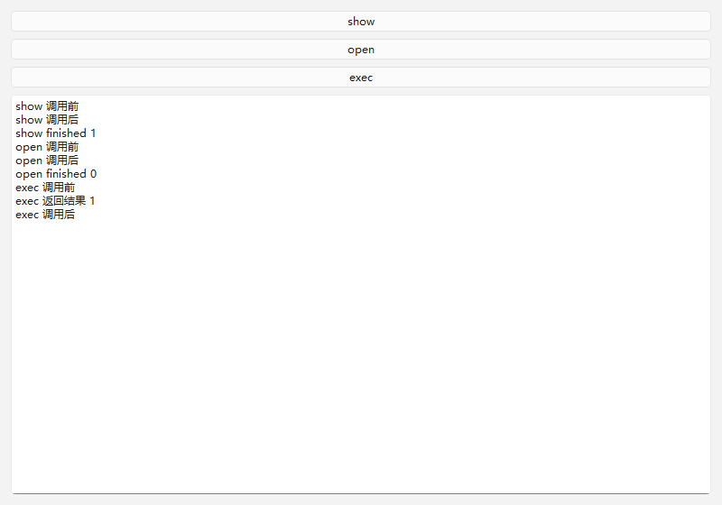
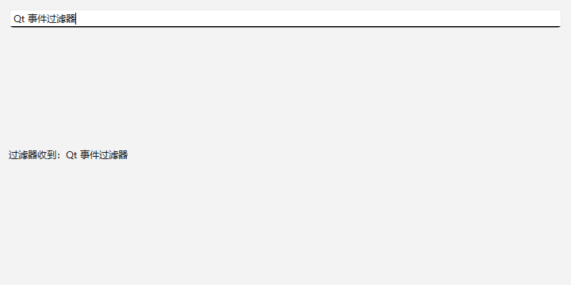
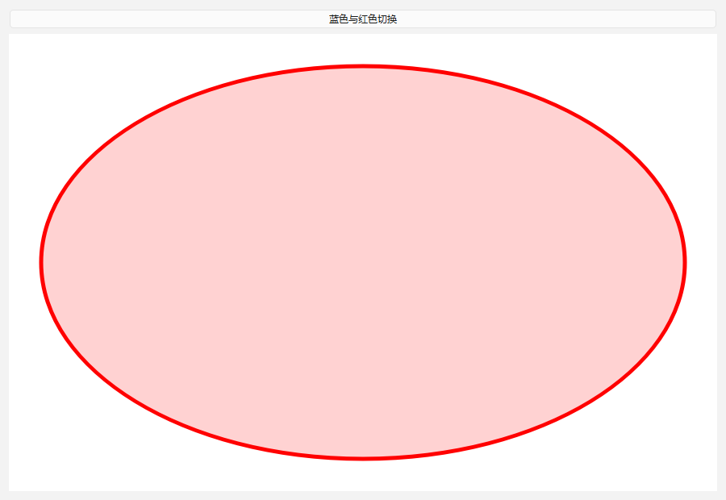

# 四个完整操作闭环

这四步将后半部分分散的知识点组合起来。建议完成第 20—37 章后再练习，每一步都能独立运行。

## 49 UTF-8 文本编辑器

[完整代码](../examples/49_text_editor/main.cpp)

这个例子真正执行打开、编辑和保存，不仅显示一个文件路径。核心状态是当前路径与 QTextDocument 的 modified 标记。打开新文档前和关闭窗口时共用 confirmDiscard：没有修改则直接继续，有修改则分别处理保存、不保存、取消。

读取先检查 QFile::open，读取完成再检查错误，成功后才替换界面文本；保存先将 QString 转成 UTF-8，再写 QSaveFile，检查写入字节数并 commit。只有确认保存成功，才清除修改标记。路径对话框取消或磁盘写入失败，都应该保留原文档。

本例按 UTF-8 解释文本，并使用 readAll，适合小型文本学习。大文件、编码检测、异步读取与多文档管理可作为后续扩展。

练习顺序：输入两行中文 → 另存为自己的测试文件 → 关闭重新打开 → 修改后关闭并点取消 → 再关闭选择保存。自动检查在 QTemporaryDir 内验证 UTF-8 写入、读回和修改状态，不操作用户已有文件。

## 50 对话框三种调用方式

[完整代码](../examples/50_dialog_modes/main.cpp)

分别点击 show、open、exec，然后观察调用前、调用后与结果通知的先后顺序。show 和 open 会立即返回，exec 等到关闭后返回结果；但 exec 内部仍在处理事件，因此按钮可以点击，自动检查中的 QTimer 也能工作。

异步对象通过 parent 与 WA_DeleteOnClose 管理，exec 示例使用栈对象，函数返回后自动析构。两者都不是“new 永远更好”或“栈永远不能用”，关键是对象必须活到最后一次使用结束。

练习：对每种入口分别点确定和取消，写出 Accepted/Rejected 出现的位置；在非模态 show 打开时尝试操作父窗口，在 open 打开时再尝试一次。

## 51 不继承输入框也能处理事件

[完整代码](../examples/51_event_filter/main.cpp)

ReturnFilter 继承 QObject，安装在普通 QLineEdit 上。收到事件时先判断 KeyPress，再读取键值；识别 Return 或小键盘 Enter 后更新结果标签并返回 true，消费事件。其余情况交给 QObject::eventFilter。

过滤器与目标控件放在同一窗口管理下。这里的 QLabel 指针在过滤器工作期间持续有效；如果将过滤器移到另一个更长寿的对象上，需要重新检查结果标签的生命期。

练习：同时给输入框连接 returnPressed，然后比较过滤器返回 true 与返回基类结果时，原信号是否还能触发。这样可以实际观察“消费事件”的含义。

## 52 交互绘图在重绘后保持状态

[完整代码](../examples/52_interactive_paint/main.cpp)

DrawingArea 只保存 color_，按钮调用 setColor 改状态并 update；paintEvent 根据当前颜色和当前 rect 重新绘图。没有把 QPainter 保存成长期成员，也没有让按钮直接在屏幕上临时画一次。

QPen 控制轮廓，带透明度的 QColor 作为画刷控制填充。绘制区域从窗口矩形缩进得到，因此缩放时仍能适应。自动检查既确认成员颜色变红，也检查真实渲染图像中存在红色轮廓像素，避免只修改数据而没有更新显示。

练习：增加线宽输入框，用同样的“修改状态 → update → paintEvent”流程更新线宽。切换颜色后遮挡窗口并恢复，确认结果仍然正确。

