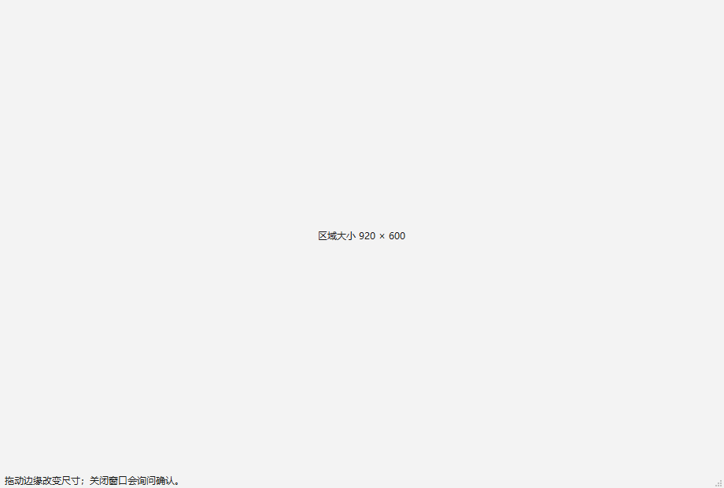

# 10.2 关闭事件与尺寸变化

对应示例：[完整源码](../../examples/45_close_resize)。先运行项目观察行为，再按以下顺序阅读。

## 本章要解决的问题

事件是 QEvent 的对象，由事件系统送到目标 QObject。QWidget 的 event() 会根据类型分派到 closeEvent、resizeEvent 等专用处理函数；按钮 clicked 则是较高层的信号通知。二者经常配合，但不是同一个概念。

在头文件 protected 区声明 void closeEvent(QCloseEvent *event) override，源文件实现。accept 允许关闭，ignore 拒绝关闭；不要调用 close() 重新触发自己。resizeEvent 的 size 是新尺寸，oldSize 是旧尺寸，首次事件的旧尺寸可能无效。resizeEvent 中尽量避免无条件再次 resize，以免递归。

## 关闭请求和尺寸通知是不同事件

closeEvent 收到的是关闭请求，ignore 可以让窗口继续存在；resizeEvent 通知的是尺寸已经变化，不是拿来询问是否允许缩放。不要在 closeEvent 里再次调用 close 引发递归，也不要在 resizeEvent 中无条件再次 resize 制造事件循环。

## 按执行顺序拆解

mainwindow.ui 的中央标签提升为 EventArea，eventarea.cpp 的 resizeEvent 显示区域尺寸。mainwindow.h 声明主窗口 closeEvent，mainwindow.cpp 根据 Yes/No 决定 accept/ignore。关闭逻辑在主窗口，尺寸显示逻辑在中央区域，职责分开。

## 参数与行为边界

事件参数只在当前调用中有效，不要把 QCloseEvent* 或 QResizeEvent* 保存到异步回调后再使用。若要异步询问关闭，可以先 ignore，本次事件结束后显示异步对话框，确认后设置状态并重新发起关闭请求。

## 易错点与排查

override 用于检查是否真正覆盖了基类虚函数。保留原有处理通常要调用基类对应函数，但关闭拦截中拒绝后不要再调用会重新接受关闭的默认处理。本例自动验证会分别选择 No 与 Yes。

遇到问题时先区分三个层次：编译错误检查声明、头文件与构建配置；界面无反应检查连接、接收对象与生存期；运行结果不对检查输入、返回值和分支是否真正执行。可以先在连接入口记录一条日志，再在结果处理处记录一条，定位中间哪一步没有到达。

## 完整示例与配套文件

本步按统一模板拆分文件。先打开 .ui 观察界面，再读窗口类；[项目 README](../../examples/45_close_resize/README.md) 提供逐项 Designer 设置。

### main.cpp

```cpp
#include "mainwindow.h"

#include <QApplication>

int main(int argc, char *argv[])
{
    QApplication a(argc, argv);
    MainWindow w;
    w.show();
    return QApplication::exec();
}
```

### mainwindow.h

```cpp
#ifndef MAINWINDOW_H
#define MAINWINDOW_H

#include <QMainWindow>

QT_BEGIN_NAMESPACE
namespace Ui
{
class MainWindow;
}
QT_END_NAMESPACE

class MainWindow : public QMainWindow
{
    Q_OBJECT

public:
    explicit MainWindow(QWidget *parent = nullptr);
    ~MainWindow() override;

protected:
    void closeEvent(QCloseEvent *event) override;

private:
    Ui::MainWindow *ui;
};
#endif // MAINWINDOW_H
```

### mainwindow.cpp

```cpp
#include "mainwindow.h"
#include "ui_mainwindow.h"
#include <QMessageBox>
#include <QCloseEvent>
#include "verify.h"

MainWindow::MainWindow(QWidget *parent)
    : QMainWindow(parent)
    , ui(new Ui::MainWindow)
{
    ui->setupUi(this);
    ui->statusbar->showMessage("拖动边缘改变尺寸；关闭窗口会询问确认。");

    // 仅带 --verify 参数时安排检查；正常学习时不会执行。
    scheduleVerification(this);
}

MainWindow::~MainWindow()
{
    delete ui;
}

void MainWindow::closeEvent(QCloseEvent *event)
{
    auto choice = QMessageBox::question(this, "关闭确认", "确定关闭窗口吗？",
                                        QMessageBox::Yes | QMessageBox::No, QMessageBox::No);
    if (choice == QMessageBox::Yes)
        event->accept();
    else
        event->ignore();
}
```

### mainwindow.ui

```xml
<?xml version="1.0" encoding="UTF-8"?>
<ui version="4.0">
 <class>MainWindow</class>
 <widget class="QMainWindow" name="MainWindow">
  <property name="geometry">
   <rect>
    <x>0</x>
    <y>0</y>
    <width>800</width>
    <height>580</height>
   </rect>
  </property>
  <property name="windowTitle">
   <string>45 关闭事件与尺寸变化</string>
  </property>
  <widget class="EventArea" name="eventArea" />
  <widget class="QStatusBar" name="statusbar" />
 </widget>
 <customwidgets>
  <customwidget>
   <class>EventArea</class>
   <extends>QLabel</extends>
   <header>eventarea.h</header>
  </customwidget>
 </customwidgets>
 <resources />
 <connections />
</ui>
```

### eventarea.cpp

```cpp
#include "eventarea.h"
#include <QMouseEvent>
#include <QResizeEvent>
#include <QKeyEvent>

EventArea::EventArea(QWidget *parent)
    : QLabel(parent)
{
    setMouseTracking(true);
    setFocusPolicy(Qt::StrongFocus);
    setAlignment(Qt::AlignCenter);
    setText("拖动主窗口边缘观察尺寸变化。");
}

void EventArea::resizeEvent(QResizeEvent *event)
{
    setText(QString("区域大小 %1 × %2").arg(event->size().width()).arg(event->size().height()));
    QLabel::resizeEvent(event);
}
```

### eventarea.h

```cpp
#ifndef EVENTAREA_H
#define EVENTAREA_H
#include <QLabel>
class EventArea : public QLabel
{
    Q_OBJECT
public:
    explicit EventArea(QWidget *parent = nullptr);

protected:
    void resizeEvent(QResizeEvent *event) override;
};
#endif // EVENTAREA_H
```

### 45_close_resize.pro

```qmake
QT += widgets

CONFIG += c++17

#DEFINES += QT_DISABLE_DEPRECATED_BEFORE=0x060000

SOURCES += \
    eventarea.cpp \
    main.cpp \
    mainwindow.cpp

HEADERS += \
    eventarea.h \
    mainwindow.h \
    verify.h

FORMS += \
    mainwindow.ui


# Default rules for deployment.
qnx: target.path = /tmp/$${TARGET}/bin
else: unix:!android: target.path = /opt/$${TARGET}/bin
!isEmpty(target.path): INSTALLS += target
```

[verify.h](../../examples/45_close_resize/verify.h) 是可选运行检查，普通启动不会执行。构建期生成的 ui_*.h 和 moc 文件不手写。

## 运行截图与观察



## 自己动手

第一次关闭选 No，确认窗口仍显示；第二次选 Yes，确认窗口退出。改变窗口大小后记录旧新尺寸。再思考怎样让编辑器修改未保存时才询问，而不是每次关闭都询问。

先写下预期行为，再修改代码、重新构建，最后对照实际结果。程序没有报错不等于逻辑已经正确，尤其要测试取消、空输入、重复操作和失败分支。

## 自测与答案

**在拒绝关闭后还调用默认 closeEvent 有何问题？**

默认实现可能接受这次关闭请求，覆盖你的拒绝决策。需要保留的基类行为必须结合事件种类判断，不能机械地在每个函数末尾调用。

## 继续阅读

- [Qt 官方文档](https://doc.qt.io/qt-6/qwidget.html)
- [项目构建方法](../getting-started.md)
- [自动检查范围](../validation.md)
