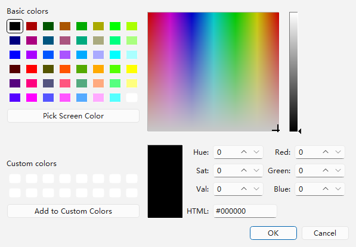
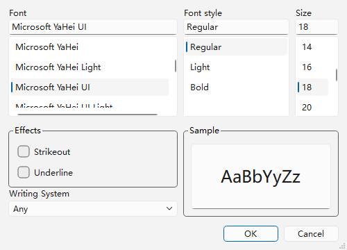
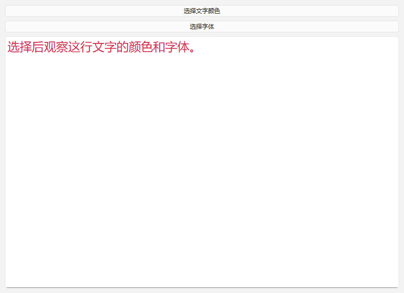

# 7.4 确认颜色或字体后再应用 理论补充

对应示例：[完整源码](../../examples/07_04_color_font)。先运行项目观察行为，再按以下顺序阅读。

## 本章要解决的问题

QColorDialog::getColor 返回 QColor；取消返回无效颜色，先 isValid() 再应用。QFontDialog::getFont 使用 bool *ok 告诉调用者是否确认选择；只在 ok 为 true 时使用返回字体。把取消也当成有效结果，会意外改变用户当前设置。

颜色要应用到合适的调色板角色。QPlainTextEdit 的文字使用 QPalette::Text，普通 QLabel 的文字通常是 WindowText。先取原有 palette，仅改所需角色，再 setPalette，能够保留其他颜色。字体同样先从控件 font() 取得当前值。本项目用对象形式的颜色和字体对话框，以 open() 连接 colorSelected、fontSelected，确认后再更新编辑器。

## 区分用户正在选和已经确认

颜色对话框的 currentColorChanged 描述选择过程，colorSelected 通常用于最终确认；如果把预览直接永久应用，用户点取消时还需要恢复原值。字体也要区分预览、确认与取消。初学时先只连接最终选择信号，能更容易保证取消后原状态不变。

## 按执行顺序拆解

mainwindow.ui 配置颜色、字体按钮和 plainTextEdit。mainwindow.cpp 在按钮回调中读取编辑器当前的 palette 或 font，建立 Qt 标准对话框，确认选择后再通过 colorSelected/fontSelected 应用结果。取消时保持原状态。

## 参数与行为边界

QPalette::Text 用于输入类控件的文字；WindowText 常用于标签类文字；Base 用于文本输入区背景；Window 用于窗口背景。主题或样式表可能覆盖调色板效果，遇到颜色没变时也要检查这些设置。setFont 改整体字体，QTextEdit 选区格式则需要字符格式相关 API。

## 易错点与排查

QPlainTextEdit 整体字体与富文本局部字符格式是不同层级。设置整体 font 不等于给 QTextEdit 当前选区设置字符格式。对话框取消应该保持原显示。

遇到问题时先区分三个层次：编译错误检查声明、头文件与构建配置；界面无反应检查连接、接收对象与生存期；运行结果不对检查输入、返回值和分支是否真正执行。可以先在连接入口记录一条日志，再在结果处理处记录一条，定位中间哪一步没有到达。

## 完整示例与配套文件

本步按统一模板拆分文件。先打开 .ui 观察界面，再读窗口类；[项目 README](../../examples/07_04_color_font/README.md) 提供逐项 Designer 设置。

### main.cpp

```cpp
#include "mainwindow.h"

#include <QApplication>

int main(int argc, char *argv[])
{
    QApplication a(argc, argv);
    MainWindow w;
    w.show();
    return QApplication::exec();
}
```

### mainwindow.h

```cpp
#ifndef MAINWINDOW_H
#define MAINWINDOW_H

#include <QMainWindow>

QT_BEGIN_NAMESPACE
namespace Ui
{
class MainWindow;
}
QT_END_NAMESPACE

class MainWindow : public QMainWindow
{
    Q_OBJECT

public:
    explicit MainWindow(QWidget *parent = nullptr);
    ~MainWindow() override;

private:
    Ui::MainWindow *ui;
};
#endif // MAINWINDOW_H
```

### mainwindow.cpp

```cpp
#include "mainwindow.h"
#include "ui_mainwindow.h"
#include <QColorDialog>
#include <QFontDialog>
#include "verify.h"

MainWindow::MainWindow(QWidget *parent)
    : QMainWindow(parent)
    , ui(new Ui::MainWindow)
{
    ui->setupUi(this);
    connect(ui->run, &QPushButton::clicked, this,
            [this]()
            {
                auto *dialog =
                    new QColorDialog(ui->plainTextEdit->palette().color(QPalette::Text), this);
                dialog->setOption(QColorDialog::DontUseNativeDialog);
                dialog->setAttribute(Qt::WA_DeleteOnClose);
                connect(dialog, &QColorDialog::colorSelected, ui->plainTextEdit,
                        [this](const QColor &value)
                        {
                            auto pal = ui->plainTextEdit->palette();
                            pal.setColor(QPalette::Text, value);
                            ui->plainTextEdit->setPalette(pal);
                        });
                dialog->open();
            });
    connect(ui->fontButton, &QPushButton::clicked, this,
            [this]()
            {
                auto *dialog = new QFontDialog(ui->plainTextEdit->font(), this);
                dialog->setOption(QFontDialog::DontUseNativeDialog);
                dialog->setAttribute(Qt::WA_DeleteOnClose);
                connect(dialog, &QFontDialog::fontSelected, ui->plainTextEdit, &QWidget::setFont);
                dialog->open();
            });

    // 仅带 --verify 参数时安排检查；正常学习时不会执行。
    scheduleVerification(this);
}

MainWindow::~MainWindow()
{
    delete ui;
}
```

### mainwindow.ui

```xml
<?xml version="1.0" encoding="UTF-8"?>
<ui version="4.0">
 <class>MainWindow</class>
 <widget class="QMainWindow" name="MainWindow">
  <property name="geometry">
   <rect>
    <x>0</x>
    <y>0</y>
    <width>800</width>
    <height>580</height>
   </rect>
  </property>
  <property name="windowTitle">
   <string>38 选择颜色与字体</string>
  </property>
  <widget class="QWidget" name="centralwidget">
   <layout class="QVBoxLayout" name="verticalLayout">
    <item>
     <widget class="QPushButton" name="run">
      <property name="text">
       <string>选择文字颜色</string>
      </property>
     </widget>
    </item>
    <item>
     <widget class="QPushButton" name="fontButton">
      <property name="text">
       <string>选择字体</string>
      </property>
     </widget>
    </item>
    <item>
     <widget class="QPlainTextEdit" name="plainTextEdit">
      <property name="plainText">
       <string>选择后观察这行文字的颜色和字体。</string>
      </property>
     </widget>
    </item>
   </layout>
  </widget>
 </widget>
 <resources />
 <connections />
</ui>
```

### 07_04_color_font.pro

```qmake
QT += widgets

CONFIG += c++17

#DEFINES += QT_DISABLE_DEPRECATED_BEFORE=0x060000

SOURCES += \
    main.cpp \
    mainwindow.cpp

HEADERS += \
    mainwindow.h \
    verify.h

FORMS += \
    mainwindow.ui


# Default rules for deployment.
qnx: target.path = /tmp/$${TARGET}/bin
else: unix:!android: target.path = /opt/$${TARGET}/bin
!isEmpty(target.path): INSTALLS += target
```

[verify.h](../../examples/07_04_color_font/verify.h) 是可选运行检查，普通启动不会执行。构建期生成的 ui_*.h 和 moc 文件不手写。

## 运行截图与观察







## 自己动手

增加一个重置按钮，恢复启动时缓存的 QPalette 和 QFont。再尝试同时修改背景与文字，避免低对比度。比较只改 Text 与只改 WindowText 对 QPlainTextEdit 的不同结果。

先写下预期行为，再修改代码、重新构建，最后对照实际结果。程序没有报错不等于逻辑已经正确，尤其要测试取消、空输入、重复操作和失败分支。

## 自测与答案

**为什么取消返回值仍看起来像某种字体？**

字体对象本身不能替代确认状态。使用静态 getFont 时看 ok；对象形式则把最终应用连接到 fontSelected，不把任意当前预览值当作确认。

## 继续阅读

- [Qt 官方文档](https://doc.qt.io/qt-6/qfontdialog.html)
- [项目构建方法](../getting-started.md)
- [自动检查范围](../validation.md)
