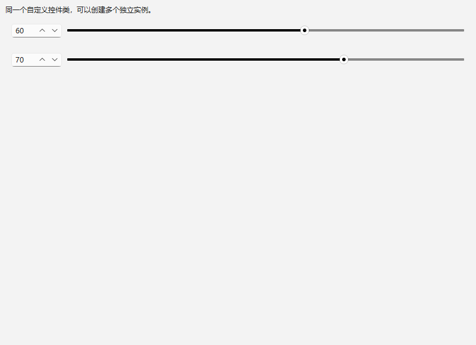

# 9.3 组合控件与 Designer 提升

对应示例：[完整源码](../../examples/43_custom_widget)。先运行项目观察行为，再按以下顺序阅读。

## 本章要解决的问题

自定义控件是把重复出现的交互封装成可创建多个实例的类。这里把 QSpinBox 和 QSlider 组合到 SmallWidget，统一数值范围，双向连接数值变化，并提供 setValue()/value()。调用者不需要知道内部布局。

双向连接并不必然无限递归：这里 setValue 只有数值真正改变才发信号，回写相同值不会再次发射。若自定义 setter 每次都发信号，就要先判断是否变化，必要时使用 QSignalBlocker。封装的目标是复用定义和行为，不是让整个应用只创建一个对象。

## 把内部结构藏在稳定接口后面

组合控件把多个标准控件组织成一个可复用组件。外部调用者只知道 setValue 和 value，不需要知道滑块放左边还是右边。复制的是类定义和设计，不是强迫所有页面共享同一个实例。需要多处独立状态时创建多个对象即可。

## 按执行顺序拆解

mainwindow.ui 中 first 和 second 已提升为 SmallWidget。分别打开 smallwidget.h、smallwidget.cpp 和 smallwidget.ui：SpinBox 与 Slider 由 .ui 创建，C++ 连接双向数值同步，并提供 setValue/value 接口。主窗口将两个实例分别初始化为 25 与 70。

## 参数与行为边界

Designer 提升分成五步：添加普通 QWidget，占位对象改名；右键提升；基类选 QWidget；填写 SmallWidget 和 smallwidget.h；添加后执行提升。构建器必须能够找到头文件，构造函数应支持 QWidget *parent。提升不自动生成 SmallWidget 的实现。

## 易错点与排查

Designer 中先放 QWidget 占位，提升类名填 SmallWidget，头文件填 smallwidget.h，再提升；类必须可包含且构造函数能接受 QWidget *parent。提升不保证设计器预览能运行自定义代码。示例附 smallwidget.h，可直接用于提升。

遇到问题时先区分三个层次：编译错误检查声明、头文件与构建配置；界面无反应检查连接、接收对象与生存期；运行结果不对检查输入、返回值和分支是否真正执行。可以先在连接入口记录一条日志，再在结果处理处记录一条，定位中间哪一步没有到达。

## 完整示例与配套文件

本步按统一模板拆分文件。先打开 .ui 观察界面，再读窗口类；[项目 README](../../examples/43_custom_widget/README.md) 提供逐项 Designer 设置。

### main.cpp

```cpp
#include "mainwindow.h"

#include <QApplication>

int main(int argc, char *argv[])
{
    QApplication a(argc, argv);
    MainWindow w;
    w.show();
    return QApplication::exec();
}
```

### mainwindow.h

```cpp
#ifndef MAINWINDOW_H
#define MAINWINDOW_H

#include <QMainWindow>

QT_BEGIN_NAMESPACE
namespace Ui
{
class MainWindow;
}
QT_END_NAMESPACE

class MainWindow : public QMainWindow
{
    Q_OBJECT

public:
    explicit MainWindow(QWidget *parent = nullptr);
    ~MainWindow() override;

private:
    Ui::MainWindow *ui;
};
#endif // MAINWINDOW_H
```

### mainwindow.cpp

```cpp
#include "mainwindow.h"
#include "ui_mainwindow.h"

#include "verify.h"

MainWindow::MainWindow(QWidget *parent)
    : QMainWindow(parent)
    , ui(new Ui::MainWindow)
{
    ui->setupUi(this);
    ui->first->setValue(25);
    ui->second->setValue(70);

    // 仅带 --verify 参数时安排检查；正常学习时不会执行。
    scheduleVerification(this);
}

MainWindow::~MainWindow()
{
    delete ui;
}
```

### mainwindow.ui

```xml
<?xml version="1.0" encoding="UTF-8"?>
<ui version="4.0">
 <class>MainWindow</class>
 <widget class="QMainWindow" name="MainWindow">
  <property name="geometry">
   <rect>
    <x>0</x>
    <y>0</y>
    <width>800</width>
    <height>580</height>
   </rect>
  </property>
  <property name="windowTitle">
   <string>43 组合控件与 Designer 提升</string>
  </property>
  <widget class="QWidget" name="centralwidget">
   <layout class="QVBoxLayout" name="verticalLayout">
    <item>
     <widget class="QLabel" name="hintLabel">
      <property name="text">
       <string>同一个自定义控件类，可以创建多个独立实例。</string>
      </property>
     </widget>
    </item>
    <item>
     <widget class="SmallWidget" name="first" />
    </item>
    <item>
     <widget class="SmallWidget" name="second" />
    </item>
    <item>
     <spacer name="verticalSpacer">
      <property name="orientation">
       <enum>Qt::Vertical</enum>
      </property>
      <property name="sizeHint" stdset="0">
       <size>
        <width>20</width>
        <height>40</height>
       </size>
      </property>
     </spacer>
    </item>
   </layout>
  </widget>
 </widget>
 <customwidgets>
  <customwidget>
   <class>SmallWidget</class>
   <extends>QWidget</extends>
   <header>smallwidget.h</header>
   <container>1</container>
  </customwidget>
 </customwidgets>
 <resources />
 <connections />
</ui>
```

### smallwidget.cpp

```cpp
#include "smallwidget.h"
#include "ui_smallwidget.h"

SmallWidget::SmallWidget(QWidget *parent)
    : QWidget(parent)
    , ui(new Ui::SmallWidget)
{
    ui->setupUi(this);
    connect(ui->spinBox, &QSpinBox::valueChanged, ui->horizontalSlider, &QSlider::setValue);
    connect(ui->horizontalSlider, &QSlider::valueChanged, ui->spinBox, &QSpinBox::setValue);
}

SmallWidget::~SmallWidget()
{
    delete ui;
}

void SmallWidget::setValue(int value)
{
    ui->spinBox->setValue(value);
}

int SmallWidget::value() const
{
    return ui->spinBox->value();
}
```

### smallwidget.h

```cpp
#ifndef SMALLWIDGET_H
#define SMALLWIDGET_H

#include <QWidget>

QT_BEGIN_NAMESPACE
namespace Ui
{
class SmallWidget;
}
QT_END_NAMESPACE

class SmallWidget : public QWidget
{
    Q_OBJECT

public:
    explicit SmallWidget(QWidget *parent = nullptr);
    ~SmallWidget() override;
    void setValue(int value);
    int value() const;

private:
    Ui::SmallWidget *ui;
};
#endif // SMALLWIDGET_H
```

### smallwidget.ui

```xml
<?xml version="1.0" encoding="UTF-8"?>
<ui version="4.0">
 <class>SmallWidget</class>
 <widget class="QWidget" name="SmallWidget">
  <property name="geometry">
   <rect>
    <x>0</x>
    <y>0</y>
    <width>500</width>
    <height>80</height>
   </rect>
  </property>
  <property name="windowTitle">
   <string>SmallWidget</string>
  </property>
  <layout class="QHBoxLayout" name="horizontalLayout">
   <item>
    <widget class="QSpinBox" name="spinBox">
     <property name="maximum">
      <number>100</number>
     </property>
    </widget>
   </item>
   <item>
    <widget class="QSlider" name="horizontalSlider">
     <property name="orientation">
      <enum>Qt::Horizontal</enum>
     </property>
     <property name="maximum">
      <number>100</number>
     </property>
    </widget>
   </item>
  </layout>
 </widget>
 <resources />
 <connections />
</ui>
```

### 43_custom_widget.pro

```qmake
QT += widgets

CONFIG += c++17

#DEFINES += QT_DISABLE_DEPRECATED_BEFORE=0x060000

SOURCES += \
    main.cpp \
    mainwindow.cpp \
    smallwidget.cpp

HEADERS += \
    mainwindow.h \
    smallwidget.h \
    verify.h

FORMS += \
    mainwindow.ui \
    smallwidget.ui


# Default rules for deployment.
qnx: target.path = /tmp/$${TARGET}/bin
else: unix:!android: target.path = /opt/$${TARGET}/bin
!isEmpty(target.path): INSTALLS += target
```

[verify.h](../../examples/43_custom_widget/verify.h) 是可选运行检查，普通启动不会执行。构建期生成的 ui_*.h 和 moc 文件不手写。

## 运行截图与观察



## 自己动手

新建一个 .ui，把 QWidget 提升为 SmallWidget，运行后读取 value。再把两个组件放到不同页面，确认数值独立。若需要对外通知变化，可添加 valueChanged(int) 信号，并只在真正变化时发出。

先写下预期行为，再修改代码、重新构建，最后对照实际结果。程序没有报错不等于逻辑已经正确，尤其要测试取消、空输入、重复操作和失败分支。

## 自测与答案

**如何避免互相 setValue 时无限循环？**

优先让 setter 检查数值是否变化。必要时用 QSignalBlocker 在同步期间暂时阻断回发，不能仅仅假定所有自定义 setter 都和 QSpinBox 一样。

## 继续阅读

- [Qt 官方文档](https://doc.qt.io/qt-6/designer-using-custom-widgets.html)
- [项目构建方法](../getting-started.md)
- [自动检查范围](../validation.md)
