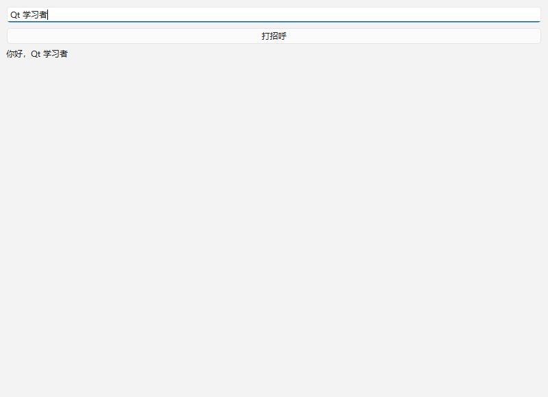

# 2.2 Designer自动连接 理论补充

对应示例：[完整源码](../../examples/02_02_designer)。先运行项目观察行为，再按以下顺序阅读。

## 本章要解决的问题

Designer 将界面保存在 .ui XML 文件中，构建时 uic 生成 ui_mainwindow.h。mainwindow.h 用前向声明保存 Ui::MainWindow *ui；mainwindow.cpp 包含生成的头文件，在构造函数中创建辅助对象、调用 ui->setupUi(this)，在析构函数中 delete ui。

objectName 是代码成员和自动连接所依赖的对象名，text 是显示文字。按钮名为 runButton，槽名为 on_runButton_clicked，且在 private slots 中声明，因此 setupUi 会自动完成连接。

## 默认模板与自动连接

本步 main.cpp 与 Qt Creator 默认模板一致，只启动 MainWindow。控件和布局都在 mainwindow.ui，行为写在 mainwindow.cpp。不要修改 ui_mainwindow.h，也不要对已自动连接的槽再 connect 一次。Designer 中“转到槽”会帮你生成相应声明和实现。

## 按执行顺序拆解

main.cpp 创建 MainWindow。mainwindow.h 声明 Ui::MainWindow *ui 和 on_runButton_clicked 槽；mainwindow.cpp 在初始化列表创建 Ui 辅助对象，再调用 ui->setupUi(this)。这个调用会建立 .ui 中的控件并自动连接 runButton 的 clicked 信号。点击后只执行对应槽，析构时 delete ui。

## 参数与行为边界

Qt Creator 向导常用 Ui::MainWindow *ui；new 出来的包装器需要 delete ui。这个 delete 释放包装器，不是要求你手动逐个 delete 其所有子控件。ui_*.h 每次构建可能重新生成，不应手动修补它来解决错误。

## 易错点与排查

不要手动改 ui_mainwindow.h，重新构建会覆盖。应该改 mainwindow.ui 或自己的 .cpp。QMainWindow 的布局要放在 centralwidget 上。示例提供真实 .ui，可直接在 Qt Creator 中双击打开。

遇到问题时先区分三个层次：编译错误检查声明、头文件与构建配置；界面无反应检查连接、接收对象与生存期；运行结果不对检查输入、返回值和分支是否真正执行。可以先在连接入口记录一条日志，再在结果处理处记录一条，定位中间哪一步没有到达。

## 完整示例与配套文件

本步按统一模板拆分文件。先打开 .ui 观察界面，再读窗口类；[项目 README](../../examples/02_02_designer/README.md) 提供逐项 Designer 设置。

### main.cpp

```cpp
#include "mainwindow.h"

#include <QApplication>

int main(int argc, char *argv[])
{
    QApplication a(argc, argv);
    MainWindow w;
    w.show();
    return QApplication::exec();
}
```

### mainwindow.h

```cpp
#ifndef MAINWINDOW_H
#define MAINWINDOW_H

#include <QMainWindow>

QT_BEGIN_NAMESPACE
namespace Ui
{
class MainWindow;
}
QT_END_NAMESPACE

class MainWindow : public QMainWindow
{
    Q_OBJECT

public:
    explicit MainWindow(QWidget *parent = nullptr);
    ~MainWindow() override;

private slots:
    void on_runButton_clicked();

private:
    Ui::MainWindow *ui;
};
#endif // MAINWINDOW_H
```

### mainwindow.cpp

```cpp
#include "mainwindow.h"
#include "ui_mainwindow.h"

#include "verify.h"

MainWindow::MainWindow(QWidget *parent)
    : QMainWindow(parent)
    , ui(new Ui::MainWindow)
{
    ui->setupUi(this);
    // setupUi 会按 on_对象名_信号名 规则连接下方的槽；不要再重复 connect。

    // 仅带 --verify 参数时安排检查；正常学习时不会执行。
    scheduleVerification(this);
}

MainWindow::~MainWindow()
{
    delete ui;
}

void MainWindow::on_runButton_clicked()
{
    ui->resultLabel->setText("你好，" + ui->nameEdit->text());
}
```

### mainwindow.ui

```xml
<?xml version="1.0" encoding="UTF-8"?>
<ui version="4.0">
 <class>MainWindow</class>
 <widget class="QMainWindow" name="MainWindow">
  <property name="geometry">
   <rect>
    <x>0</x>
    <y>0</y>
    <width>800</width>
    <height>580</height>
   </rect>
  </property>
  <property name="windowTitle">
   <string>35 Designer 与 setupUi</string>
  </property>
  <widget class="QWidget" name="centralwidget">
   <layout class="QVBoxLayout" name="verticalLayout">
    <item>
     <widget class="QLineEdit" name="nameEdit">
      <property name="placeholderText">
       <string>请输入名字</string>
      </property>
     </widget>
    </item>
    <item>
     <widget class="QPushButton" name="runButton">
      <property name="text">
       <string>打招呼</string>
      </property>
     </widget>
    </item>
    <item>
     <widget class="QLabel" name="resultLabel">
      <property name="text">
       <string>等待点击</string>
      </property>
     </widget>
    </item>
    <item>
     <spacer name="verticalSpacer">
      <property name="orientation">
       <enum>Qt::Vertical</enum>
      </property>
      <property name="sizeHint" stdset="0">
       <size>
        <width>20</width>
        <height>40</height>
       </size>
      </property>
     </spacer>
    </item>
   </layout>
  </widget>
 </widget>
 <resources />
 <connections />
</ui>
```

### 02_02_designer.pro

```qmake
QT += widgets

CONFIG += c++17

#DEFINES += QT_DISABLE_DEPRECATED_BEFORE=0x060000

SOURCES += \
    main.cpp \
    mainwindow.cpp

HEADERS += \
    mainwindow.h \
    verify.h

FORMS += \
    mainwindow.ui


# Default rules for deployment.
qnx: target.path = /tmp/$${TARGET}/bin
else: unix:!android: target.path = /opt/$${TARGET}/bin
!isEmpty(target.path): INSTALLS += target
```

[verify.h](../../examples/02_02_designer/verify.h) 是可选运行检查，普通启动不会执行。构建期生成的 ui_*.h 和 moc 文件不手写。

## 运行截图与观察



## 自己动手

在 mainwindow.ui 添加 clearButton，使用“转到槽”生成 on_clearButton_clicked，在槽中调用 ui->nameEdit->clear。修改按钮的显示文字，确认自动连接仍然有效；再修改 objectName，观察为什么槽名也需要同步修改。

## 自测与答案

**已经有 on_runButton_clicked，还需要再写 connect 吗？**

不需要。setupUi 调用 connectSlotsByName，会按对象名和槽名自动连接。再添加相同的显式连接会让一次点击执行两次。要使用另一种连接方式，应先去掉旧的连接。

## 继续阅读

- [Qt 官方文档](https://doc.qt.io/qt-6/designer-using-custom-widgets.html)
- [项目构建方法](../getting-started.md)
- [自动检查范围](../validation.md)
