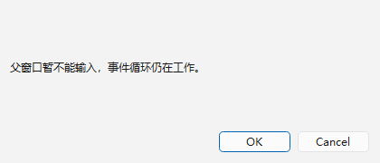
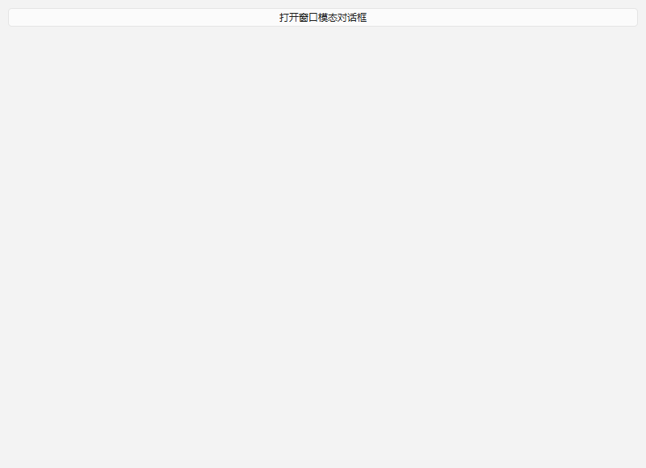

# 7.1 异步对话框的生命周期 理论补充

对应示例：[完整源码](../../examples/07_01_dialog)。先运行项目观察行为，再按以下顺序阅读。

## 本章要解决的问题

模态决定其他窗口能否接受输入；阻塞决定调用处代码是否等待返回。exec() 显示模态对话框并等待返回，它会运行嵌套事件循环，因此对话框本身仍能响应。open() 默认按窗口模态显示并立即返回，通常连接 finished、accepted 或 rejected 处理结果。show() 通常用于非模态显示，但也会受事先设置的 modality 属性影响。

局部栈对象 dialog.show() 一闪而过的根本原因是函数返回后对象立即析构。异步显示应让对象持续存在，例如 new QDialog(&w)，并设置 WA_DeleteOnClose。仅有 parent 能在父窗口销毁时回收，不等于每次关掉对话框立即回收。

## 是否模态和是否等待是两条轴

一个对话框可能限制其他窗口的输入，却不阻塞调用处代码。open 就属于这种情况。exec 等待结果，但内部仍继续处理对话框事件，所以“阻塞代码”不等于整个 GUI 线程停止工作。嵌套事件循环会带来重入，调用之前保存的对象状态可能在对话框打开期间被其他事件改变。

## 按执行顺序拆解

mainwindow.ui 提供入口按钮；dialog.ui 提供自定义 Dialog 的标签与标准按钮。点击入口后 new Dialog(this)，其构造函数加载自己的 .ui；设置 WA_DeleteOnClose 后调用 open。项目 7.2进一步对照 show/open/exec，区分窗口模态和调用是否等待。

## 参数与行为边界

栈对象不是永远不能用：局部 QDialog dialog; dialog.exec(); 可以活到 exec 返回。问题出在局部对象配 show/open 后函数马上返回。异步版本应使用能存活的对象，合理设置 parent 和 WA_DeleteOnClose。持有可能被关闭删除的指针时，可用 QPointer 检测对象是否仍存在。

## 易错点与排查

open() 和 show() 后不要让对象立即离开作用域。exec() 的栈对象可活到返回，但新代码通常优先考虑 open() 加结果信号，减少嵌套事件循环。对话框有 parent 仍可作为独立顶层对话框显示，不是普通嵌入控件。

遇到问题时先区分三个层次：编译错误检查声明、头文件与构建配置；界面无反应检查连接、接收对象与生存期；运行结果不对检查输入、返回值和分支是否真正执行。可以先在连接入口记录一条日志，再在结果处理处记录一条，定位中间哪一步没有到达。

## 完整示例与配套文件

本步按统一模板拆分文件。先打开 .ui 观察界面，再读窗口类；[项目 README](../../examples/07_01_dialog/README.md) 提供逐项 Designer 设置。

### main.cpp

```cpp
#include "mainwindow.h"

#include <QApplication>

int main(int argc, char *argv[])
{
    QApplication a(argc, argv);
    MainWindow w;
    w.show();
    return QApplication::exec();
}
```

### mainwindow.h

```cpp
#ifndef MAINWINDOW_H
#define MAINWINDOW_H

#include <QMainWindow>

QT_BEGIN_NAMESPACE
namespace Ui
{
class MainWindow;
}
QT_END_NAMESPACE

class MainWindow : public QMainWindow
{
    Q_OBJECT

public:
    explicit MainWindow(QWidget *parent = nullptr);
    ~MainWindow() override;

private:
    Ui::MainWindow *ui;
};
#endif // MAINWINDOW_H
```

### mainwindow.cpp

```cpp
#include "mainwindow.h"
#include "ui_mainwindow.h"
#include "dialog.h"
#include "verify.h"

MainWindow::MainWindow(QWidget *parent)
    : QMainWindow(parent)
    , ui(new Ui::MainWindow)
{
    ui->setupUi(this);
    connect(ui->run, &QPushButton::clicked, this,
            [this]()
            {
                auto *dialog = new Dialog(this);
                dialog->setAttribute(Qt::WA_DeleteOnClose);
                dialog->setWindowTitle("open 立即返回");
                dialog->open();
            });

    // 仅带 --verify 参数时安排检查；正常学习时不会执行。
    scheduleVerification(this);
}

MainWindow::~MainWindow()
{
    delete ui;
}
```

### mainwindow.ui

```xml
<?xml version="1.0" encoding="UTF-8"?>
<ui version="4.0">
 <class>MainWindow</class>
 <widget class="QMainWindow" name="MainWindow">
  <property name="geometry">
   <rect>
    <x>0</x>
    <y>0</y>
    <width>800</width>
    <height>580</height>
   </rect>
  </property>
  <property name="windowTitle">
   <string>36 模态 非模态与对象生命期</string>
  </property>
  <widget class="QWidget" name="centralwidget">
   <layout class="QVBoxLayout" name="verticalLayout">
    <item>
     <widget class="QPushButton" name="run">
      <property name="text">
       <string>打开窗口模态对话框</string>
      </property>
     </widget>
    </item>
    <item>
     <spacer name="verticalSpacer">
      <property name="orientation">
       <enum>Qt::Vertical</enum>
      </property>
      <property name="sizeHint" stdset="0">
       <size>
        <width>20</width>
        <height>40</height>
       </size>
      </property>
     </spacer>
    </item>
   </layout>
  </widget>
 </widget>
 <resources />
 <connections />
</ui>
```

### dialog.cpp

```cpp
#include "dialog.h"
#include "ui_dialog.h"

Dialog::Dialog(QWidget *parent)
    : QDialog(parent)
    , ui(new Ui::Dialog)
{
    ui->setupUi(this);
}

Dialog::~Dialog()
{
    delete ui;
}
```

### dialog.h

```cpp
#ifndef DIALOG_H
#define DIALOG_H

#include <QDialog>

QT_BEGIN_NAMESPACE
namespace Ui
{
class Dialog;
}
QT_END_NAMESPACE

class Dialog : public QDialog
{
    Q_OBJECT

public:
    explicit Dialog(QWidget *parent = nullptr);
    ~Dialog() override;

private:
    Ui::Dialog *ui;
};
#endif // DIALOG_H
```

### dialog.ui

```xml
<?xml version="1.0" encoding="UTF-8"?>
<ui version="4.0">
 <class>Dialog</class>
 <widget class="QDialog" name="Dialog">
  <property name="geometry">
   <rect>
    <x>0</x>
    <y>0</y>
    <width>420</width>
    <height>180</height>
   </rect>
  </property>
  <property name="windowTitle">
   <string>示例对话框</string>
  </property>
  <layout class="QVBoxLayout" name="verticalLayout">
   <item>
    <widget class="QLabel" name="hintLabel">
     <property name="text">
      <string>父窗口暂不能输入，事件循环仍在工作。</string>
     </property>
    </widget>
   </item>
   <item>
    <widget class="QDialogButtonBox" name="buttonBox">
     <property name="standardButtons">
      <set>QDialogButtonBox::Cancel|QDialogButtonBox::Ok</set>
     </property>
    </widget>
   </item>
  </layout>
 </widget>
 <resources />
 <connections>
  <connection>
   <sender>buttonBox</sender>
   <signal>accepted()</signal>
   <receiver>Dialog</receiver>
   <slot>accept()</slot>
  </connection>
  <connection>
   <sender>buttonBox</sender>
   <signal>rejected()</signal>
   <receiver>Dialog</receiver>
   <slot>reject()</slot>
  </connection>
 </connections>
</ui>
```

### 07_01_dialog.pro

```qmake
QT += widgets

CONFIG += c++17

#DEFINES += QT_DISABLE_DEPRECATED_BEFORE=0x060000

SOURCES += \
    dialog.cpp \
    main.cpp \
    mainwindow.cpp

HEADERS += \
    dialog.h \
    mainwindow.h \
    verify.h

FORMS += \
    dialog.ui \
    mainwindow.ui


# Default rules for deployment.
qnx: target.path = /tmp/$${TARGET}/bin
else: unix:!android: target.path = /opt/$${TARGET}/bin
!isEmpty(target.path): INSTALLS += target
```

[verify.h](../../examples/07_01_dialog/verify.h) 是可选运行检查，普通启动不会执行。构建期生成的 ui_*.h 和 moc 文件不手写。

## 运行截图与观察





## 自己动手

打开项目 7.2，按 show、open、exec 分别测试确定和取消，观察日志顺序。再把 open 改成 show，比较父窗口是否可操作。不要对设置 DeleteOnClose 的对象关闭后继续调用成员。

先写下预期行为，再修改代码、重新构建，最后对照实际结果。程序没有报错不等于逻辑已经正确，尤其要测试取消、空输入、重复操作和失败分支。

## 自测与答案

**异步对话框必须写完 result=dialog->open() 吗？**

不可以。open 不用返回值传递选择结果，应提前 connect 到结果信号，并在 Lambda 中读取仍然存活的目标状态。

## 继续阅读

- [Qt 官方文档](https://doc.qt.io/qt-6/qdialog.html)
- [项目构建方法](../getting-started.md)
- [自动检查范围](../validation.md)
