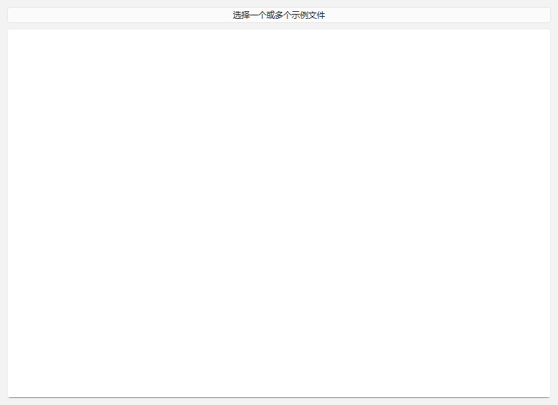

# 7.3 文件选择与取消处理 理论补充

对应示例：[完整源码](../../examples/07_03_file_dialog)。先运行项目观察行为，再按以下顺序阅读。

## 本章要解决的问题

getOpenFileName 返回 QString，getOpenFileNames 返回 QStringList；取消时分别得到空字符串或空列表。parent 用于归属，caption 是标题，dir 是起始目录，filter 是过滤规则。Images (*.png *.jpg);;Text (*.txt) 中 ;; 分隔多组过滤器。

文件选择只返回路径，不会把文件内容读到编辑框里。要读取还需 QFile 打开、检查错误、读取内容和处理编码。本项目明确只显示选中的路径。示例使用 QFileDialog 对象加 open() 与 filesSelected 信号，因此能以同样方式展示多个文件，取消时不执行选择后的逻辑。

## 选择路径与文件读写要分成两步

文件选择对话框只解决“用户要哪个路径”，QFile 才负责“这个路径能否打开、读到什么”。过滤器主要帮助用户选择，不是对文件内容的真实性验证。扩展名是 txt 也不保证内容就是 UTF-8 文本。读取后还要决定编码、大小限制和失败时是否保留当前文档。

## 按执行顺序拆解

先在 mainwindow.ui 确认 run 按钮和 resultEdit。点击后创建 QFileDialog，设置多选、过滤器、自动删除属性，再连接 filesSelected；选择文件后才将结果列表写入 resultEdit。取消不会进入选择结果逻辑。项目 7.6继续实现真正的文件读取和保存。

## 参数与行为边界

getOpenFileName 取消返回空字符串，getOpenFileNames 返回空列表；getSaveFileName 返回目标路径，不会自动完成写入。读取现有文件用 QFile，整份文档覆盖保存优先考虑 QSaveFile。文本内容从 QString 到字节数组需要明确编码，不要把本地编码和 UTF-8 混用。

## 易错点与排查

./ 依赖当前工作目录，未必是源码所在目录。示例用构建时提供的 QT_LESSON_SOURCE_DIR 定位源码中的 samples；发布应用时应改用用户目录或部署后的资源位置。为了截图可复现，使用 Qt 非原生对话框；实际程序可以根据平台选择原生外观。

遇到问题时先区分三个层次：编译错误检查声明、头文件与构建配置；界面无反应检查连接、接收对象与生存期；运行结果不对检查输入、返回值和分支是否真正执行。可以先在连接入口记录一条日志，再在结果处理处记录一条，定位中间哪一步没有到达。

## 完整示例与配套文件

本步按统一模板拆分文件。先打开 .ui 观察界面，再读窗口类；[项目 README](../../examples/07_03_file_dialog/README.md) 提供逐项 Designer 设置。

### main.cpp

```cpp
#include "mainwindow.h"

#include <QApplication>

int main(int argc, char *argv[])
{
    QApplication a(argc, argv);
    MainWindow w;
    w.show();
    return QApplication::exec();
}
```

### mainwindow.h

```cpp
#ifndef MAINWINDOW_H
#define MAINWINDOW_H

#include <QMainWindow>

QT_BEGIN_NAMESPACE
namespace Ui
{
class MainWindow;
}
QT_END_NAMESPACE

class MainWindow : public QMainWindow
{
    Q_OBJECT

public:
    explicit MainWindow(QWidget *parent = nullptr);
    ~MainWindow() override;

private:
    Ui::MainWindow *ui;
};
#endif // MAINWINDOW_H
```

### mainwindow.cpp

```cpp
#include "mainwindow.h"
#include "ui_mainwindow.h"
#include <QFileDialog>
#include "verify.h"

MainWindow::MainWindow(QWidget *parent)
    : QMainWindow(parent)
    , ui(new Ui::MainWindow)
{
    ui->setupUi(this);
    connect(ui->run, &QPushButton::clicked, this,
            [this]()
            {
                auto *dialog = new QFileDialog(this, "选择文件",
                                               QStringLiteral(QT_LESSON_SOURCE_DIR "/samples"));
                dialog->setOption(QFileDialog::DontUseNativeDialog);
                dialog->setFileMode(QFileDialog::ExistingFiles);
                dialog->setNameFilter("Text (*.txt);;Images (*.png *.jpg)");
                dialog->setAttribute(Qt::WA_DeleteOnClose);
                connect(dialog, &QFileDialog::filesSelected, ui->resultEdit,
                        [this](const QStringList &files)
                        { ui->resultEdit->setPlainText(files.join('\n')); });
                dialog->open();
            });

    // 仅带 --verify 参数时安排检查；正常学习时不会执行。
    scheduleVerification(this);
}

MainWindow::~MainWindow()
{
    delete ui;
}
```

### mainwindow.ui

```xml
<?xml version="1.0" encoding="UTF-8"?>
<ui version="4.0">
 <class>MainWindow</class>
 <widget class="QMainWindow" name="MainWindow">
  <property name="geometry">
   <rect>
    <x>0</x>
    <y>0</y>
    <width>800</width>
    <height>580</height>
   </rect>
  </property>
  <property name="windowTitle">
   <string>37 单文件 多文件与取消</string>
  </property>
  <widget class="QWidget" name="centralwidget">
   <layout class="QVBoxLayout" name="verticalLayout">
    <item>
     <widget class="QPushButton" name="run">
      <property name="text">
       <string>选择一个或多个示例文件</string>
      </property>
     </widget>
    </item>
    <item>
     <widget class="QTextEdit" name="resultEdit">
      <property name="readOnly">
       <bool>true</bool>
      </property>
     </widget>
    </item>
   </layout>
  </widget>
 </widget>
 <resources />
 <connections />
</ui>
```

### 07_03_file_dialog.pro

```qmake
QT += widgets

CONFIG += c++17

#DEFINES += QT_DISABLE_DEPRECATED_BEFORE=0x060000

SOURCES += \
    main.cpp \
    mainwindow.cpp

HEADERS += \
    mainwindow.h \
    verify.h

FORMS += \
    mainwindow.ui


DEFINES += QT_LESSON_SOURCE_DIR=\\\"$$PWD\\\"

# Default rules for deployment.
qnx: target.path = /tmp/$${TARGET}/bin
else: unix:!android: target.path = /opt/$${TARGET}/bin
!isEmpty(target.path): INSTALLS += target
```

[verify.h](../../examples/07_03_file_dialog/verify.h) 是可选运行检查，普通启动不会执行。构建期生成的 ui_*.h 和 moc 文件不手写。

## 运行截图与观察



## 自己动手

用项目 7.6创建含中文和换行的文本，另存到自己的测试目录，关闭后重新打开。再选择不可写目录观察错误。对未保存内容发起打开或关闭，分别选择保存、不保存和取消，确认取消不会丢掉当前内容。

先写下预期行为，再修改代码、重新构建，最后对照实际结果。程序没有报错不等于逻辑已经正确，尤其要测试取消、空输入、重复操作和失败分支。

## 自测与答案

**保存后能立即把 modified 设成 false 吗？**

只有写入完整并且 commit 成功后才可以。用户取消路径选择或者磁盘写入失败时，保存未完成，当前文档仍应标记为修改过。

## 继续阅读

- [Qt 官方文档](https://doc.qt.io/qt-6/qfiledialog.html)
- [项目构建方法](../getting-started.md)
- [自动检查范围](../validation.md)
