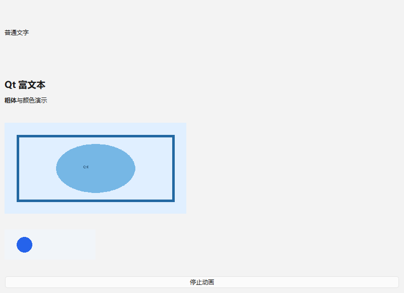

# 9.1 标签的文本图像与动画接口 理论补充

对应示例：[完整源码](../../examples/09_01_label_movie)。先运行项目观察行为，再按以下顺序阅读。

## 本章要解决的问题

QLabel 可显示普通文本、受支持的 HTML 富文本、QPixmap 图片和 QMovie 动画。并不意味着完整浏览器；复杂网页不应交给 QLabel。内容来自外部输入时，可显式设 PlainText，避免自动识别为富文本。

setOpenExternalLinks(true) 会在用户点击链接后交给外部程序打开网址；本例只显示本地富文本，不自动跳转。setPixmap 绑定图片；setMovie 绑定动画，但 QLabel 不接管 QMovie 的所有权，应 new QMovie(..., parent) 指定父对象，并调用 start()。stop() 停止播放，setPaused(true) 暂停。

## QLabel 的四种内容走不同接口

setText 接收文本，setPixmap 接收像素图，setMovie 接收动画对象。设置字符串 :/images/demo.png 并不会让 QLabel 读取图片。富文本采用 Qt 支持的子集，不等于浏览器完整 HTML/CSS。对用户输入使用 PlainText，可避免误把尖括号内容当作格式标签。

## 按执行顺序拆解

普通文字、富文本、图片标签、动画标签和停止按钮均在 mainwindow.ui。mainwindow.cpp 只负责装载图片和 QMovie，将动画交给标签显示并调用 start。QMovie 的 parent 是当前主窗口；停止按钮显式连接 QMovie::stop。

## 参数与行为边界

设置固定目标尺寸并等比缩放，会留下空白；scaledContents(true) 可能直接拉伸。高 DPI 图片还涉及逻辑尺寸与 devicePixelRatio，不应只按物理像素数猜显示大小。需要随容器大小调整图片时，可在尺寸变化时更新缩放结果，避免在无关事件里重复加载。

## 易错点与排查

显示 GIF 的 QMovie 不要漏 parent。标签不会自动把资源路径文本变成图片，必须加载 QPixmap 或 QMovie。原笔记的资源图片若未随项目提供，在其他电脑就会显示空白；本例随附 qrc、PNG 和 GIF。

遇到问题时先区分三个层次：编译错误检查声明、头文件与构建配置；界面无反应检查连接、接收对象与生存期；运行结果不对检查输入、返回值和分支是否真正执行。可以先在连接入口记录一条日志，再在结果处理处记录一条，定位中间哪一步没有到达。

## 完整示例与配套文件

本步按统一模板拆分文件。先打开 .ui 观察界面，再读窗口类；[项目 README](../../examples/09_01_label_movie/README.md) 提供逐项 Designer 设置。

### main.cpp

```cpp
#include "mainwindow.h"

#include <QApplication>

int main(int argc, char *argv[])
{
    QApplication a(argc, argv);
    MainWindow w;
    w.show();
    return QApplication::exec();
}
```

### mainwindow.h

```cpp
#ifndef MAINWINDOW_H
#define MAINWINDOW_H

#include <QMainWindow>

QT_BEGIN_NAMESPACE
namespace Ui
{
class MainWindow;
}
QT_END_NAMESPACE

class MainWindow : public QMainWindow
{
    Q_OBJECT

public:
    explicit MainWindow(QWidget *parent = nullptr);
    ~MainWindow() override;

private:
    Ui::MainWindow *ui;
};
#endif // MAINWINDOW_H
```

### mainwindow.cpp

```cpp
#include "mainwindow.h"
#include "ui_mainwindow.h"
#include <QMovie>
#include "verify.h"

MainWindow::MainWindow(QWidget *parent)
    : QMainWindow(parent)
    , ui(new Ui::MainWindow)
{
    ui->setupUi(this);
    ui->imageLabel->setPixmap(QPixmap(":/images/demo.png").scaledToWidth(360));
    auto *movie = new QMovie(":/images/demo.gif", QByteArray(), this);
    ui->animationLabel->setMovie(movie);
    movie->start();
    connect(ui->run, &QPushButton::clicked, movie, &QMovie::stop);

    // 仅带 --verify 参数时安排检查；正常学习时不会执行。
    scheduleVerification(this);
}

MainWindow::~MainWindow()
{
    delete ui;
}
```

### mainwindow.ui

```xml
<?xml version="1.0" encoding="UTF-8"?>
<ui version="4.0">
 <class>MainWindow</class>
 <widget class="QMainWindow" name="MainWindow">
  <property name="geometry">
   <rect>
    <x>0</x>
    <y>0</y>
    <width>800</width>
    <height>580</height>
   </rect>
  </property>
  <property name="windowTitle">
   <string>41 QLabel 文本 图片与动画</string>
  </property>
  <widget class="QWidget" name="centralwidget">
   <layout class="QVBoxLayout" name="verticalLayout">
    <item>
     <widget class="QLabel" name="plainLabel">
      <property name="text">
       <string>普通文字</string>
      </property>
     </widget>
    </item>
    <item>
     <widget class="QLabel" name="richLabel">
      <property name="text">
       <string>&lt;h2&gt;Qt 富文本&lt;/h2&gt;&lt;p&gt;&lt;b&gt;粗体&lt;/b&gt;与颜色演示&lt;/p&gt;</string>
      </property>
     </widget>
    </item>
    <item>
     <widget class="QLabel" name="imageLabel" />
    </item>
    <item>
     <widget class="QLabel" name="animationLabel" />
    </item>
    <item>
     <widget class="QPushButton" name="run">
      <property name="text">
       <string>停止动画</string>
      </property>
     </widget>
    </item>
   </layout>
  </widget>
 </widget>
 <resources>
  <include location="assets.qrc" />
 </resources>
 <connections />
</ui>
```

### 09_01_label_movie.pro

```qmake
QT += widgets

CONFIG += c++17

#DEFINES += QT_DISABLE_DEPRECATED_BEFORE=0x060000

SOURCES += \
    main.cpp \
    mainwindow.cpp

HEADERS += \
    mainwindow.h \
    verify.h

FORMS += \
    mainwindow.ui

RESOURCES += \
    assets.qrc

# Default rules for deployment.
qnx: target.path = /tmp/$${TARGET}/bin
else: unix:!android: target.path = /opt/$${TARGET}/bin
!isEmpty(target.path): INSTALLS += target
```

### assets.qrc

```xml
<RCC><qresource prefix="/images"><file alias="demo.png">assets/demo.png</file><file alias="demo.gif">assets/demo.gif</file></qresource></RCC>
```

[verify.h](../../examples/09_01_label_movie/verify.h) 是可选运行检查，普通启动不会执行。构建期生成的 ui_*.h 和 moc 文件不手写。

## 运行截图与观察



## 自己动手

把标签改为纯文本并传入 <b>Qt</b>，观察它是否显示原始标签。分别测试 movie.stop、setPaused(true)、start，比较停止与暂停的区别。把图片目标尺寸改成长条，比较等比与拉伸结果。

先写下预期行为，再修改代码、重新构建，最后对照实际结果。程序没有报错不等于逻辑已经正确，尤其要测试取消、空输入、重复操作和失败分支。

## 自测与答案

**标签析构会自动 delete movie 吗？**

setMovie 不接管动画对象。应通过 QObject parent 或其他明确的生命周期方案管理它，不要仅凭“在标签里显示”判断归属。

## 继续阅读

- [Qt 官方文档](https://doc.qt.io/qt-6/qlabel.html)
- [项目构建方法](../getting-started.md)
- [自动检查范围](../validation.md)
