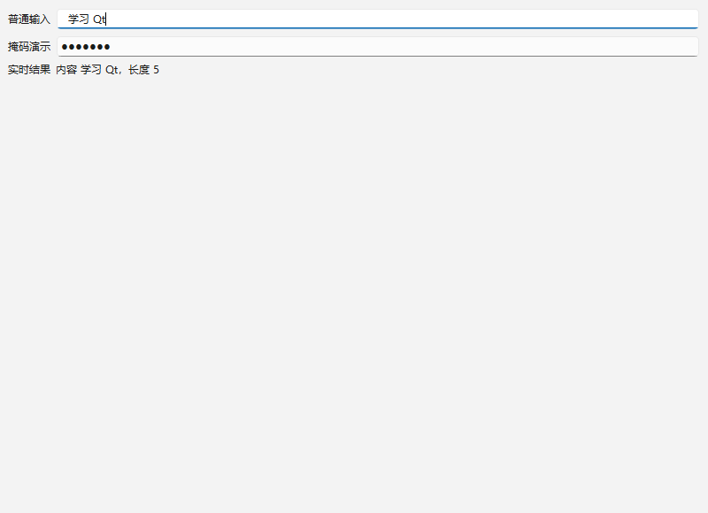

# 9.2 输入内容与显示模式 理论补充

对应示例：[完整源码](../../examples/09_02_lineedit)。先运行项目观察行为，再按以下顺序阅读。

## 本章要解决的问题

QLineEdit 用于单行输入，setText 写入，text() 读取真实内容。placeholderText 是空内容时的提示，不是输入值；设置它不会让 text() 返回提示。textChanged 会响应用户和代码设置的变化，textEdited 主要响应用户编辑，returnPressed 用于回车触发。

四种 EchoMode 为 Normal、NoEcho、Password、PasswordEchoOnEdit。NoEcho 不显示字符；Password 显示掩码；PasswordEchoOnEdit 在编辑时显示、非编辑时掩码。显示模式只改变外观，text() 仍是实际字符串。setTextMargins 控制框内边距，不是移动控件本身。

## 输入值 显示值和编辑动作

QLineEdit::text() 是真实字符串，displayText() 是按 EchoMode 处理后的显示内容。placeholderText 只在空值时提示，它不会成为真实文本。代码 setText 也会触发 textChanged，但通常不属于 textEdited 所描述的用户编辑，这个差别常用于避免把程序回填当成用户输入。

## 按执行顺序拆解

在 mainwindow.ui 中查看 name 的 placeholderText、passwordEdit 的 Password 显示模式和三行表单。mainwindow.cpp 设置文本边距并连接 textChanged。输入后 resultLabel 同时显示内容和长度；清空后 placeholderText 只作提示，不属于 text()。

## 参数与行为边界

setMaxLength 限制长度；QValidator 可以约束可接受输入；inputMask 适合固定形状。验证器可能有 Intermediate 状态，因此输入过程中暂时不完整不一定是 Invalid。returnPressed 与 editingFinished 的触发还可能受验证状态影响，不能只看某一帧文本就提交业务。

## 易错点与排查

密码掩码不是加密，不应把敏感密码打印到日志。本例仅用固定的演示文本，并只显示长度。清空后 text() 是空字符串，不是 placeholder 文本。

遇到问题时先区分三个层次：编译错误检查声明、头文件与构建配置；界面无反应检查连接、接收对象与生存期；运行结果不对检查输入、返回值和分支是否真正执行。可以先在连接入口记录一条日志，再在结果处理处记录一条，定位中间哪一步没有到达。

## 完整示例与配套文件

本步按统一模板拆分文件。先打开 .ui 观察界面，再读窗口类；[项目 README](../../examples/09_02_lineedit/README.md) 提供逐项 Designer 设置。

### main.cpp

```cpp
#include "mainwindow.h"

#include <QApplication>

int main(int argc, char *argv[])
{
    QApplication a(argc, argv);
    MainWindow w;
    w.show();
    return QApplication::exec();
}
```

### mainwindow.h

```cpp
#ifndef MAINWINDOW_H
#define MAINWINDOW_H

#include <QMainWindow>

QT_BEGIN_NAMESPACE
namespace Ui
{
class MainWindow;
}
QT_END_NAMESPACE

class MainWindow : public QMainWindow
{
    Q_OBJECT

public:
    explicit MainWindow(QWidget *parent = nullptr);
    ~MainWindow() override;

private:
    Ui::MainWindow *ui;
};
#endif // MAINWINDOW_H
```

### mainwindow.cpp

```cpp
#include "mainwindow.h"
#include "ui_mainwindow.h"

#include "verify.h"

MainWindow::MainWindow(QWidget *parent)
    : QMainWindow(parent)
    , ui(new Ui::MainWindow)
{
    ui->setupUi(this);
    ui->name->setTextMargins(8, 0, 8, 0);
    connect(ui->name, &QLineEdit::textChanged, this, [this](const QString &text)
            { ui->resultLabel->setText(QString("内容 %1，长度 %2").arg(text).arg(text.size())); });

    // 仅带 --verify 参数时安排检查；正常学习时不会执行。
    scheduleVerification(this);
}

MainWindow::~MainWindow()
{
    delete ui;
}
```

### mainwindow.ui

```xml
<?xml version="1.0" encoding="UTF-8"?>
<ui version="4.0">
 <class>MainWindow</class>
 <widget class="QMainWindow" name="MainWindow">
  <property name="geometry">
   <rect>
    <x>0</x>
    <y>0</y>
    <width>800</width>
    <height>580</height>
   </rect>
  </property>
  <property name="windowTitle">
   <string>42 QLineEdit 输入与显示模式</string>
  </property>
  <widget class="QWidget" name="centralwidget">
   <layout class="QFormLayout" name="formLayout">
    <item row="0" column="0">
     <widget class="QLabel" name="fieldLabel0">
      <property name="text">
       <string>普通输入</string>
      </property>
     </widget>
    </item>
    <item row="0" column="1">
     <widget class="QLineEdit" name="name">
      <property name="placeholderText">
       <string>请输入名字</string>
      </property>
     </widget>
    </item>
    <item row="1" column="0">
     <widget class="QLabel" name="fieldLabel1">
      <property name="text">
       <string>掩码演示</string>
      </property>
     </widget>
    </item>
    <item row="1" column="1">
     <widget class="QLineEdit" name="passwordEdit">
      <property name="text">
       <string>demo123</string>
      </property>
      <property name="echoMode">
       <enum>QLineEdit::Password</enum>
      </property>
     </widget>
    </item>
    <item row="2" column="0">
     <widget class="QLabel" name="fieldLabel2">
      <property name="text">
       <string>实时结果</string>
      </property>
     </widget>
    </item>
    <item row="2" column="1">
     <widget class="QLabel" name="resultLabel">
      <property name="text">
       <string>尚未输入</string>
      </property>
     </widget>
    </item>
   </layout>
  </widget>
 </widget>
 <resources />
 <connections />
</ui>
```

### 09_02_lineedit.pro

```qmake
QT += widgets

CONFIG += c++17

#DEFINES += QT_DISABLE_DEPRECATED_BEFORE=0x060000

SOURCES += \
    main.cpp \
    mainwindow.cpp

HEADERS += \
    mainwindow.h \
    verify.h

FORMS += \
    mainwindow.ui


# Default rules for deployment.
qnx: target.path = /tmp/$${TARGET}/bin
else: unix:!android: target.path = /opt/$${TARGET}/bin
!isEmpty(target.path): INSTALLS += target
```

[verify.h](../../examples/09_02_lineedit/verify.h) 是可选运行检查，普通启动不会执行。构建期生成的 ui_*.h 和 moc 文件不手写。

## 运行截图与观察



## 自己动手

添加读取按钮，同时观察 text() 与 displayText() 的差别，但仅使用固定演示内容。给姓名设置最大长度，再给另一个输入框安装 QIntValidator，尝试空值、部分输入和超范围值。提交前使用 hasAcceptableInput 检查。

先写下预期行为，再修改代码、重新构建，最后对照实际结果。程序没有报错不等于逻辑已经正确，尤其要测试取消、空输入、重复操作和失败分支。

## 自测与答案

**把 echoMode 改成 Password 就能安全保存密码吗？**

它只隐藏显示，不加密内存、日志或磁盘数据。不要把输入展示策略当作数据保护或账号认证方案。

## 继续阅读

- [Qt 官方文档](https://doc.qt.io/qt-6/qlineedit.html)
- [项目构建方法](../getting-started.md)
- [自动检查范围](../validation.md)
