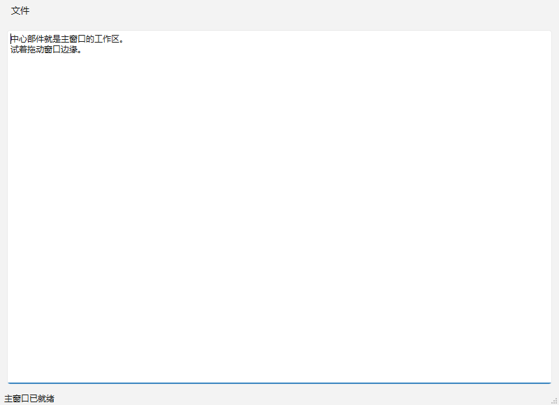

# 6.1 QMainWindow中心工作区 理论补充

对应示例：[完整源码](../../examples/06_01_mainwindow)。先运行项目观察行为，再按以下顺序阅读。

## 本章要解决的问题

QMainWindow 自带主窗口区域的组织规则：顶部菜单栏、可停靠工具栏、停靠面板、底部状态栏，以及中间的中心部件。中心部件是工作区，例如记事本的编辑器。它也继承 QWidget，但通常不直接在 QMainWindow 本体上再安装普通布局。

setCentralWidget() 把一个控件交给主窗口作为工作区。主窗口负责这个控件的所有权。若工作区含多个控件，先创建普通 QWidget 容器，把布局安装到容器，再把容器设为中心部件。窗口缩放时，这块区域会自动适应剩余空间。

## 窗口并不只是一个大 QWidget

先建立工作区，再把工作区交给主窗口。主窗口有自己管理菜单、工具栏和停靠区域的内部布局；调用 setCentralWidget 的意思是登记工作区，不是设置任意 child 的坐标。如果同时需要编辑器、查询栏和按钮，应先建一个 QWidget 容器，把 QVBoxLayout 安装到容器，再把整个容器作为中心部件。这样各部分会自然分工。

## 按执行顺序拆解

main.cpp 创建 MainWindow 并显示。构造函数先调用 ui->setupUi(this)，uic 生成的代码根据 mainwindow.ui 建立 centralwidget、布局和 textEdit，并登记主窗口的中心部件。正文的 C++ 代码只设置状态消息。先在 Designer 的对象查看器中确认层级，再看 mainwindow.cpp 的初始化。

## 参数与行为边界

QWidget 是普通控件与容器的基础；QMainWindow 适合带菜单、工具栏与停靠面板的应用；QDialog 适合短时交互。不要为了“功能更多”让所有小组件都继承 QMainWindow。

## 易错点与排查

menuBar() 和 statusBar() 可以取得或按需创建对应栏，取得后无需再调用 setMenuBar(menuBar())。setCentralWidget 会接管部件；替换时不要把旧部件当成仍可随意使用的对象。

遇到问题时先区分三个层次：编译错误检查声明、头文件与构建配置；界面无反应检查连接、接收对象与生存期；运行结果不对检查输入、返回值和分支是否真正执行。可以先在连接入口记录一条日志，再在结果处理处记录一条，定位中间哪一步没有到达。

## 完整示例与配套文件

本步按统一模板拆分文件。先打开 .ui 观察界面，再读窗口类；[项目 README](../../examples/06_01_mainwindow/README.md) 提供逐项 Designer 设置。

### main.cpp

```cpp
#include "mainwindow.h"

#include <QApplication>

int main(int argc, char *argv[])
{
    QApplication a(argc, argv);
    MainWindow w;
    w.show();
    return QApplication::exec();
}
```

### mainwindow.h

```cpp
#ifndef MAINWINDOW_H
#define MAINWINDOW_H

#include <QMainWindow>

QT_BEGIN_NAMESPACE
namespace Ui
{
class MainWindow;
}
QT_END_NAMESPACE

class MainWindow : public QMainWindow
{
    Q_OBJECT

public:
    explicit MainWindow(QWidget *parent = nullptr);
    ~MainWindow() override;

private:
    Ui::MainWindow *ui;
};
#endif // MAINWINDOW_H
```

### mainwindow.cpp

```cpp
#include "mainwindow.h"
#include "ui_mainwindow.h"

#include "verify.h"

MainWindow::MainWindow(QWidget *parent)
    : QMainWindow(parent)
    , ui(new Ui::MainWindow)
{
    ui->setupUi(this);
    ui->statusbar->showMessage("主窗口已就绪");

    // 仅带 --verify 参数时安排检查；正常学习时不会执行。
    scheduleVerification(this);
}

MainWindow::~MainWindow()
{
    delete ui;
}
```

### mainwindow.ui

```xml
<?xml version="1.0" encoding="UTF-8"?>
<ui version="4.0">
 <class>MainWindow</class>
 <widget class="QMainWindow" name="MainWindow">
  <property name="geometry">
   <rect>
    <x>0</x>
    <y>0</y>
    <width>800</width>
    <height>580</height>
   </rect>
  </property>
  <property name="windowTitle">
   <string>31 主窗口与中心部件</string>
  </property>
  <widget class="QWidget" name="centralwidget">
   <layout class="QVBoxLayout" name="verticalLayout">
    <item>
     <widget class="QTextEdit" name="textEdit">
      <property name="plainText">
       <string>中心部件就是主窗口的工作区。
试着拖动窗口边缘。</string>
      </property>
     </widget>
    </item>
   </layout>
  </widget>
  <widget class="QMenuBar" name="menubar">
   <widget class="QMenu" name="menuFile">
    <property name="title">
     <string>文件</string>
    </property>
   </widget>
   <addaction name="menuFile" />
  </widget>
  <widget class="QStatusBar" name="statusbar" />
 </widget>
 <resources />
 <connections />
</ui>
```

### 06_01_mainwindow.pro

```qmake
QT += widgets

CONFIG += c++17

#DEFINES += QT_DISABLE_DEPRECATED_BEFORE=0x060000

SOURCES += \
    main.cpp \
    mainwindow.cpp

HEADERS += \
    mainwindow.h \
    verify.h

FORMS += \
    mainwindow.ui


# Default rules for deployment.
qnx: target.path = /tmp/$${TARGET}/bin
else: unix:!android: target.path = /opt/$${TARGET}/bin
!isEmpty(target.path): INSTALLS += target
```

[verify.h](../../examples/06_01_mainwindow/verify.h) 是可选运行检查，普通启动不会执行。构建期生成的 ui_*.h 和 moc 文件不手写。

## 运行截图与观察



## 自己动手

在 mainwindow.ui 的 centralwidget 布局中增加一个 QLabel，再拖动窗口观察标签与编辑器如何分配空间。对比保留布局与取消布局时的表现，理解中心工作区与内部布局的分工。

先写下预期行为，再修改代码、重新构建，最后对照实际结果。程序没有报错不等于逻辑已经正确，尤其要测试取消、空输入、重复操作和失败分支。

## 自测与答案

**为什么没给 QTextEdit 传 parent 也能被释放？**

因为主窗口在 setCentralWidget 时取得所有权。不要再给同一个对象叠加另一个独立的所有者。

## 继续阅读

- [Qt 官方文档](https://doc.qt.io/qt-6/qmainwindow.html)
- [项目构建方法](../getting-started.md)
- [自动检查范围](../validation.md)
