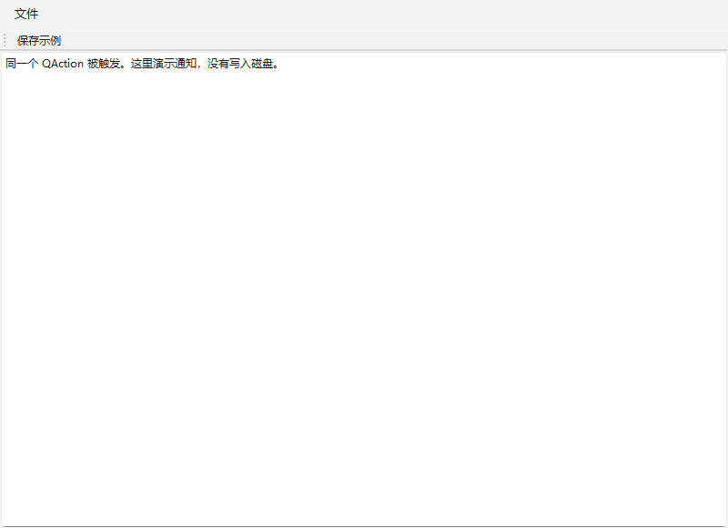

# 6.2 菜单 动作与工具栏

对应示例：[完整源码](../../examples/32_menu_toolbar)。先运行项目观察行为，再按以下顺序阅读。

## 本章要解决的问题

菜单栏 QMenuBar 容纳菜单 QMenu，菜单里放 QAction。QAction 表示一项可执行操作，保存操作可以同时出现在菜单和工具栏，它们共享文字、启用状态、勾选状态及 triggered 信号。QAction 不是另一个窗口。

把同一个 QAction 加到 QMenu 和 QToolBar 后，只需连接一次 triggered，用户从任一入口操作都进入同一段业务代码。快捷键也可以设置到动作上。工具栏可设置初始区域、允许区域、能否移动、能否浮动；这些是不同属性。

## 先定义动作 再提供多个入口

动作是“保存”这项命令，菜单项和工具栏按钮只是触发它的入口。若两个入口各自创建一份 QAction，即使文字相同，也不是同一个动作：启用状态、快捷键和勾选状态都要分别同步。把一个 QAction 分别 addAction 到菜单和工具栏，可以直接共享这些状态。

## 按执行顺序拆解

在 mainwindow.ui 中找到名为 action 的 QAction：菜单 menuFile 和 toolBar 的 addaction 均引用它。mainwindow.cpp 只有一次 triggered 连接，两个入口都会向 ui->textEdit 追加同一条消息。尝试 ui->action->setEnabled(false)，观察菜单与工具栏一起禁用。

## 参数与行为边界

triggered(bool) 通知触发，toggled(bool) 通知勾选状态变化。需要开关操作时先 setCheckable(true)，再决定监听哪个信号。构造动作时把父对象设为主窗口；添加到菜单不应成为你推断所有权的唯一依据。

## 易错点与排查

使用 Qt::LeftToolBarArea | Qt::RightToolBarArea 组合区域标志；这是按位或。setMovable(false) 控制移动把手，setFloatable(false) 控制是否可浮动，两者不应混为一谈。

遇到问题时先区分三个层次：编译错误检查声明、头文件与构建配置；界面无反应检查连接、接收对象与生存期；运行结果不对检查输入、返回值和分支是否真正执行。可以先在连接入口记录一条日志，再在结果处理处记录一条，定位中间哪一步没有到达。

## 完整示例与配套文件

本步按统一模板拆分文件。先打开 .ui 观察界面，再读窗口类；[项目 README](../../examples/32_menu_toolbar/README.md) 提供逐项 Designer 设置。

### main.cpp

```cpp
#include "mainwindow.h"

#include <QApplication>

int main(int argc, char *argv[])
{
    QApplication a(argc, argv);
    MainWindow w;
    w.show();
    return QApplication::exec();
}
```

### mainwindow.h

```cpp
#ifndef MAINWINDOW_H
#define MAINWINDOW_H

#include <QMainWindow>

QT_BEGIN_NAMESPACE
namespace Ui
{
class MainWindow;
}
QT_END_NAMESPACE

class MainWindow : public QMainWindow
{
    Q_OBJECT

public:
    explicit MainWindow(QWidget *parent = nullptr);
    ~MainWindow() override;

private:
    Ui::MainWindow *ui;
};
#endif // MAINWINDOW_H
```

### mainwindow.cpp

```cpp
#include "mainwindow.h"
#include "ui_mainwindow.h"

#include "verify.h"

MainWindow::MainWindow(QWidget *parent)
    : QMainWindow(parent)
    , ui(new Ui::MainWindow)
{
    ui->setupUi(this);
    connect(ui->action, &QAction::triggered, this, [this]()
            { ui->textEdit->append("同一个 QAction 被触发。这里演示通知，没有写入磁盘。"); });

    // 仅带 --verify 参数时安排检查；正常学习时不会执行。
    scheduleVerification(this);
}

MainWindow::~MainWindow()
{
    delete ui;
}
```

### mainwindow.ui

```xml
<?xml version="1.0" encoding="UTF-8"?>
<ui version="4.0">
 <class>MainWindow</class>
 <widget class="QMainWindow" name="MainWindow">
  <property name="geometry">
   <rect>
    <x>0</x>
    <y>0</y>
    <width>800</width>
    <height>580</height>
   </rect>
  </property>
  <property name="windowTitle">
   <string>32 菜单 动作与工具栏</string>
  </property>
  <widget class="QWidget" name="centralwidget">
   <layout class="QVBoxLayout" name="verticalLayout">
    <item>
     <widget class="QTextEdit" name="textEdit" />
    </item>
   </layout>
  </widget>
  <action name="action">
   <property name="text">
    <string>保存示例</string>
   </property>
   <property name="shortcut">
    <string>Ctrl+S</string>
   </property>
  </action>
  <widget class="QMenuBar" name="menubar">
   <widget class="QMenu" name="menuFile">
    <property name="title">
     <string>文件</string>
    </property>
    <addaction name="action" />
   </widget>
   <addaction name="menuFile" />
  </widget>
  <widget class="QToolBar" name="toolBar">
   <property name="windowTitle">
    <string>文件工具</string>
   </property>
   <property name="allowedAreas">
    <set>Qt::LeftToolBarArea|Qt::RightToolBarArea|Qt::TopToolBarArea</set>
   </property>
   <attribute name="toolBarArea">
    <enum>TopToolBarArea</enum>
   </attribute>
   <attribute name="toolBarBreak">
    <bool>false</bool>
   </attribute>
   <addaction name="action" />
  </widget>
  <widget class="QStatusBar" name="statusbar" />
 </widget>
 <resources />
 <connections />
</ui>
```

### 32_menu_toolbar.pro

```qmake
QT += widgets

CONFIG += c++17

#DEFINES += QT_DISABLE_DEPRECATED_BEFORE=0x060000

SOURCES += \
    main.cpp \
    mainwindow.cpp

HEADERS += \
    mainwindow.h \
    verify.h

FORMS += \
    mainwindow.ui


# Default rules for deployment.
qnx: target.path = /tmp/$${TARGET}/bin
else: unix:!android: target.path = /opt/$${TARGET}/bin
!isEmpty(target.path): INSTALLS += target
```

[verify.h](../../examples/32_menu_toolbar/verify.h) 是可选运行检查，普通启动不会执行。构建期生成的 ui_*.h 和 moc 文件不手写。

## 运行截图与观察



## 自己动手

增加一个“显示日志”可勾选动作，菜单和工具栏共用它，连接 toggled 控制日志区域显隐。把动作禁用，再分别从鼠标和快捷键尝试触发，比较行为。

先写下预期行为，再修改代码、重新构建，最后对照实际结果。程序没有报错不等于逻辑已经正确，尤其要测试取消、空输入、重复操作和失败分支。

## 自测与答案

**setMovable 和 setFloatable 为什么分开？**

前者控制工具栏在主窗口中的移动，后者控制能否离开主窗口浮动。初始停靠位置和允许停靠的区域又是另外两个设置。

## 继续阅读

- [Qt 官方文档](https://doc.qt.io/qt-6/qaction.html)
- [项目构建方法](../getting-started.md)
- [自动检查范围](../validation.md)
