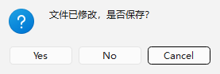
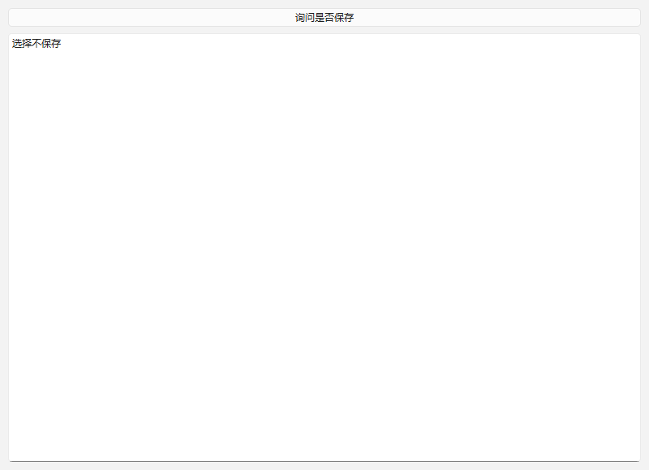

# 7.5 消息框与三种选择结果

对应示例：[完整源码](../../examples/39_messagebox)。先运行项目观察行为，再按以下顺序阅读。

## 本章要解决的问题

information、warning、critical 分别用于信息、警告和错误提示；question 用于请求决策。它们返回 QMessageBox::StandardButton，应该与 Yes、No、Cancel 等标准按钮枚举比较，不能把任何非零返回值都当成确认。

文件已修改时，“保存”“不保存”“取消”代表三种不同的控制流程：保存成功后继续，不保存则继续但放弃改动，取消则中止当前关闭或切换。示例只演示分支，把选择结果写到编辑器，不会真正保存或删除文件。defaultButton 应明确指定，本例选择 Cancel，避免随手回车就放弃改动。

## 按钮结果必须落实到控制流程

“是否保存”不是只打印三种文本。保存意味着成功写入后继续；不保存意味着放弃当前修改后继续；取消意味着停止正在进行的关闭或切换。如果保存过程失败，后续关闭仍不能继续。这个分支可以抽成 confirmDiscard()，供打开新文档与关闭窗口共同使用。

## 按执行顺序拆解

mainwindow.ui 中的 run 按钮触发消息框，结果写入 resultEdit。查看 mainwindow.cpp 如何明确比较 Yes/No/Cancel。示例 49将这些选择接入 closeEvent 与 confirmDiscard，只有保存成功或用户明确放弃修改时才允许继续。

## 参数与行为边界

information、warning、critical 的图标表达不同严重程度，不会自动抛异常、记录日志或者退出程序。question 返回标准按钮枚举，默认按钮应有意识选择。键盘 Enter 触发默认按钮，Esc 的行为还与逃逸按钮和平台约定相关，不能把所有关闭方式当作 Yes。

## 易错点与排查

about 与 aboutQt 是说明信息，不是保存决策。示例问是否保存并不构成已经实现文件保存；真正保存要检查写入是否成功。

遇到问题时先区分三个层次：编译错误检查声明、头文件与构建配置；界面无反应检查连接、接收对象与生存期；运行结果不对检查输入、返回值和分支是否真正执行。可以先在连接入口记录一条日志，再在结果处理处记录一条，定位中间哪一步没有到达。

## 完整示例与配套文件

本步按统一模板拆分文件。先打开 .ui 观察界面，再读窗口类；[项目 README](../../examples/39_messagebox/README.md) 提供逐项 Designer 设置。

### main.cpp

```cpp
#include "mainwindow.h"

#include <QApplication>

int main(int argc, char *argv[])
{
    QApplication a(argc, argv);
    MainWindow w;
    w.show();
    return QApplication::exec();
}
```

### mainwindow.h

```cpp
#ifndef MAINWINDOW_H
#define MAINWINDOW_H

#include <QMainWindow>

QT_BEGIN_NAMESPACE
namespace Ui
{
class MainWindow;
}
QT_END_NAMESPACE

class MainWindow : public QMainWindow
{
    Q_OBJECT

public:
    explicit MainWindow(QWidget *parent = nullptr);
    ~MainWindow() override;

private:
    Ui::MainWindow *ui;
};
#endif // MAINWINDOW_H
```

### mainwindow.cpp

```cpp
#include "mainwindow.h"
#include "ui_mainwindow.h"
#include <QMessageBox>
#include "verify.h"

MainWindow::MainWindow(QWidget *parent)
    : QMainWindow(parent)
    , ui(new Ui::MainWindow)
{
    ui->setupUi(this);
    connect(ui->run, &QPushButton::clicked, this,
            [this]()
            {
                auto *box =
                    new QMessageBox(QMessageBox::Question, "保存选择", "文件已修改，是否保存？",
                                    QMessageBox::Yes | QMessageBox::No | QMessageBox::Cancel, this);
                box->setDefaultButton(QMessageBox::Cancel);
                box->setAttribute(Qt::WA_DeleteOnClose);
                connect(box, &QDialog::finished, ui->resultEdit,
                        [this](int result)
                        {
                            if (result == QMessageBox::Yes)
                                ui->resultEdit->append("选择保存（仅演示）");
                            else if (result == QMessageBox::No)
                                ui->resultEdit->append("选择不保存");
                            else
                                ui->resultEdit->append("取消当前操作");
                        });
                box->open();
            });

    // 仅带 --verify 参数时安排检查；正常学习时不会执行。
    scheduleVerification(this);
}

MainWindow::~MainWindow()
{
    delete ui;
}
```

### mainwindow.ui

```xml
<?xml version="1.0" encoding="UTF-8"?>
<ui version="4.0">
 <class>MainWindow</class>
 <widget class="QMainWindow" name="MainWindow">
  <property name="geometry">
   <rect>
    <x>0</x>
    <y>0</y>
    <width>800</width>
    <height>580</height>
   </rect>
  </property>
  <property name="windowTitle">
   <string>39 消息框与三种选择结果</string>
  </property>
  <widget class="QWidget" name="centralwidget">
   <layout class="QVBoxLayout" name="verticalLayout">
    <item>
     <widget class="QPushButton" name="run">
      <property name="text">
       <string>询问是否保存</string>
      </property>
     </widget>
    </item>
    <item>
     <widget class="QTextEdit" name="resultEdit" />
    </item>
   </layout>
  </widget>
 </widget>
 <resources />
 <connections />
</ui>
```

### 39_messagebox.pro

```qmake
QT += widgets

CONFIG += c++17

#DEFINES += QT_DISABLE_DEPRECATED_BEFORE=0x060000

SOURCES += \
    main.cpp \
    mainwindow.cpp

HEADERS += \
    mainwindow.h \
    verify.h

FORMS += \
    mainwindow.ui


# Default rules for deployment.
qnx: target.path = /tmp/$${TARGET}/bin
else: unix:!android: target.path = /opt/$${TARGET}/bin
!isEmpty(target.path): INSTALLS += target
```

[verify.h](../../examples/39_messagebox/verify.h) 是可选运行检查，普通启动不会执行。构建期生成的 ui_*.h 和 moc 文件不手写。

## 运行截图与观察





## 自己动手

修改示例 39默认按钮，按 Enter 测试哪个分支被触发。再到示例 49编辑文本后关闭，选择 Yes 后取消保存路径，确认编辑器仍然打开且文本未丢失。

先写下预期行为，再修改代码、重新构建，最后对照实际结果。程序没有报错不等于逻辑已经正确，尤其要测试取消、空输入、重复操作和失败分支。

## 自测与答案

**为什么 if(result) 不够？**

Yes、No、Cancel 都是枚举值，并不把只有 Yes 定义为 true。必须显式与相应 StandardButton 比较，才能保持业务语义。

## 继续阅读

- [Qt 官方文档](https://doc.qt.io/qt-6/qmessagebox.html)
- [项目构建方法](../getting-started.md)
- [自动检查范围](../validation.md)
