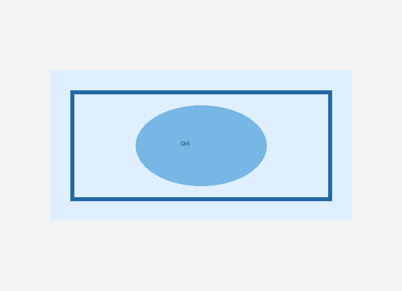

# 3.2 资源路径与图像加载 理论补充

对应示例：[完整源码](../../examples/03_02_resources)。先运行项目观察行为，再按以下顺序阅读。

## 本章要解决的问题

qrc 是资源清单，prefix 是资源前缀，alias 是资源在程序里的名字。例如前缀 /images 加别名 demo.png，运行时路径为 :/images/demo.png。这个路径与程序当前工作目录无关。qmake 项目还需要 RESOURCES += assets.qrc，构建时 rcc 才会把资源编入程序。

QPixmap 加载失败时 isNull() 为 true，先检查路径大小写、前缀、别名以及资源是否加入构建。QLabel 显示图片时，按目标区域调用 scaled(..., Qt::KeepAspectRatio, Qt::SmoothTransformation) 可以等比适应。若要做随窗口变化的背景，在 paintEvent 中基于当前 rect 绘制更直接；构造时只缩放一次不会跟随未来窗口变化。

## 磁盘路径 资源路径和显示尺寸

磁盘文件依赖部署位置和文件权限，:/ 开头的资源路径指向 Qt 资源系统。qrc 用 prefix 与 alias 构成运行时名字；XML 中 file 的内容是构建时要读取的源文件位置。因此“源码磁盘文件名”和“程序访问名字”可以不同，改了 alias 后代码也要同步。

## 按执行顺序拆解

先打开 assets.qrc 确认 prefix、alias 与素材，再打开 mainwindow.ui 查看 imageLabel。mainwindow.cpp 用资源路径读取 QPixmap，失败时显示提示，成功时设置缩放后的图像，并用同一资源设置窗口图标。资源由构建系统打包，不依赖运行工作目录。

## 参数与行为边界

isNull 用于检查图片是否加载成功。Q_ASSERT 常在 Release 被关闭，不能把生产错误处理只写成断言；要用普通 if 处理并提示。scaled 返回新图片，不会原地修改原对象。KeepAspectRatio 保持比例，KeepAspectRatioByExpanding 会铺满但可能裁剪，IgnoreAspectRatio 可能变形。

## 易错点与排查

Qt 6 中 QPalette::Window 是窗口背景角色。用图片刷填充可能出现平铺；IgnoreAspectRatio 会拉伸变形。资源文件通常打包进程序，但资源系统也支持外部 rcc，并非所有资源都必须内嵌。

遇到问题时先区分三个层次：编译错误检查声明、头文件与构建配置；界面无反应检查连接、接收对象与生存期；运行结果不对检查输入、返回值和分支是否真正执行。可以先在连接入口记录一条日志，再在结果处理处记录一条，定位中间哪一步没有到达。

## 完整示例与配套文件

本步按统一模板拆分文件。先打开 .ui 观察界面，再读窗口类；[项目 README](../../examples/03_02_resources/README.md) 提供逐项 Designer 设置。

### main.cpp

```cpp
#include "mainwindow.h"

#include <QApplication>

int main(int argc, char *argv[])
{
    QApplication a(argc, argv);
    MainWindow w;
    w.show();
    return QApplication::exec();
}
```

### mainwindow.h

```cpp
#ifndef MAINWINDOW_H
#define MAINWINDOW_H

#include <QMainWindow>

QT_BEGIN_NAMESPACE
namespace Ui
{
class MainWindow;
}
QT_END_NAMESPACE

class MainWindow : public QMainWindow
{
    Q_OBJECT

public:
    explicit MainWindow(QWidget *parent = nullptr);
    ~MainWindow() override;

private:
    Ui::MainWindow *ui;
};
#endif // MAINWINDOW_H
```

### mainwindow.cpp

```cpp
#include "mainwindow.h"
#include "ui_mainwindow.h"
#include <QPixmap>
#include <QIcon>
#include "verify.h"

MainWindow::MainWindow(QWidget *parent)
    : QMainWindow(parent)
    , ui(new Ui::MainWindow)
{
    ui->setupUi(this);
    QPixmap picture(":/images/demo.png");
    if (picture.isNull())
        ui->imageLabel->setText("图片加载失败，请检查 qrc 资源路径。");
    else
        ui->imageLabel->setPixmap(
            picture.scaled(600, 360, Qt::KeepAspectRatio, Qt::SmoothTransformation));
    setWindowIcon(QIcon(":/images/demo.png"));

    // 仅带 --verify 参数时安排检查；正常学习时不会执行。
    scheduleVerification(this);
}

MainWindow::~MainWindow()
{
    delete ui;
}
```

### mainwindow.ui

```xml
<?xml version="1.0" encoding="UTF-8"?>
<ui version="4.0">
 <class>MainWindow</class>
 <widget class="QMainWindow" name="MainWindow">
  <property name="geometry">
   <rect>
    <x>0</x>
    <y>0</y>
    <width>800</width>
    <height>580</height>
   </rect>
  </property>
  <property name="windowTitle">
   <string>34 资源路径 图片与背景</string>
  </property>
  <widget class="QWidget" name="centralwidget">
   <layout class="QVBoxLayout" name="verticalLayout">
    <item>
     <widget class="QLabel" name="imageLabel">
      <property name="alignment">
       <set>Qt::AlignCenter</set>
      </property>
     </widget>
    </item>
   </layout>
  </widget>
 </widget>
 <resources>
  <include location="assets.qrc" />
 </resources>
 <connections />
</ui>
```

### 03_02_resources.pro

```qmake
QT += widgets

CONFIG += c++17

#DEFINES += QT_DISABLE_DEPRECATED_BEFORE=0x060000

SOURCES += \
    main.cpp \
    mainwindow.cpp

HEADERS += \
    mainwindow.h \
    verify.h

FORMS += \
    mainwindow.ui

RESOURCES += \
    assets.qrc

# Default rules for deployment.
qnx: target.path = /tmp/$${TARGET}/bin
else: unix:!android: target.path = /opt/$${TARGET}/bin
!isEmpty(target.path): INSTALLS += target
```

### assets.qrc

```xml
<RCC><qresource prefix="/images"><file alias="demo.png">assets/demo.png</file><file alias="demo.gif">assets/demo.gif</file></qresource></RCC>
```

[verify.h](../../examples/03_02_resources/verify.h) 是可选运行检查，普通启动不会执行。构建期生成的 ui_*.h 和 moc 文件不手写。

## 运行截图与观察



## 自己动手

把别名故意写错，用 if (picture.isNull()) 显示失败提示。恢复路径后把缩放策略改成 IgnoreAspectRatio，对比图片是否变形。最后试着改变窗口大小，观察构造时只缩放一次的局限。

先写下预期行为，再修改代码、重新构建，最后对照实际结果。程序没有报错不等于逻辑已经正确，尤其要测试取消、空输入、重复操作和失败分支。

## 自测与答案

**背景图为什么不会跟着缩放？**

构造函数只执行一次。若背景依赖当前窗口尺寸，应在 resizeEvent 更新缓存，或在 paintEvent 根据当前 rect 绘制，并避免每次重绘都从磁盘重新加载。

## 继续阅读

- [Qt 官方文档](https://doc.qt.io/qt-6/resources.html)
- [项目构建方法](../getting-started.md)
- [自动检查范围](../validation.md)
