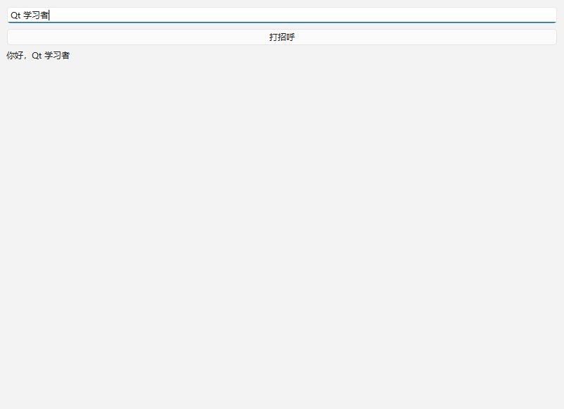

# 2.2 Designer自动连接

[教程中的本知识点](../../docs/knowledge/02_02_designer.md) · [第 2 章](../../docs/chapters/02-create-project.md)

### 本项目要掌握什么

Designer自动连接。这一节只围绕这个核心问题阅读和修改程序。

### 关键代码在哪里

关键片段 1：[ mainwindow.cpp 第 22 行起](mainwindow.cpp#L22)。以下代码从本项目源文件提取，完整上下文见源文件。

```cpp
void MainWindow::on_runButton_clicked()
{
    ui->resultLabel->setText("你好，" + ui->nameEdit->text());
}
```

### 逐段讲解

Ui 辅助对象在初始化列表创建，setupUi 根据 .ui 建立 nameEdit、runButton 与 resultLabel，并按对象名和槽名自动连接。

on_runButton_clicked 声明在 private slots 中，点击后读取输入框并设置标签。text 是显示文字，objectName 才参与连接规则。

### 按执行顺序阅读

构造函数先准备界面与连接；交互发生后才进入回调。阅读时按“发送对象 → 信号或调用 → 回调里的数据 → 被修改对象 → 显示结果”追踪，不要把建立连接当成已经执行操作。

### 容易出错的地方与动手验证

改按钮 text 不影响槽名；改 objectName 则要同步槽名。不要在自动连接之外再重复 connect。

先写下预测，再修改一个条件重新构建。记录实际结果，并用本节代码中的变量、对象和调用顺序解释原因；仅仅没有报错不代表已经验证了所有分支。

### 运行结果



### 完整项目与界面文件

- [02_02_designer.pro](02_02_designer.pro)
- [main.cpp](main.cpp)
- [mainwindow.cpp](mainwindow.cpp)
- [mainwindow.h](mainwindow.h)
- [mainwindow.ui](mainwindow.ui)
- [verify.h](verify.h)

打开本项目 .pro，选择匹配的 Kit，构建运行；修改界面请打开 .ui，保存后重新构建。verify.h 只在传入 --verify 时执行检查。

## 在 Designer 中重做界面

从空白 Widgets 模板开始时，按下表拖入控件并设置相同的 objectName。已有完整 .ui 可直接使用；geometry 只适用于没有布局管理的控件。

### mainwindow.ui

| objectName | 类型 | 主要设置 |
|---|---|---|
| `MainWindow` | QMainWindow | geometry=(0,0,800,580) |
| `centralwidget` | QWidget | 按 .ui 中的默认属性 |
| `nameEdit` | QLineEdit | placeholderText=请输入名字 |
| `runButton` | QPushButton | text=打招呼 |
| `resultLabel` | QLabel | text=等待点击 |
| `verticalLayout` | QVBoxLayout | 布局内的控件交给布局分配空间 |

本步使用 `on_runButton_clicked()` 自动连接。已在 private slots 声明，不要再重复 connect；其他示例以显式连接为主。
