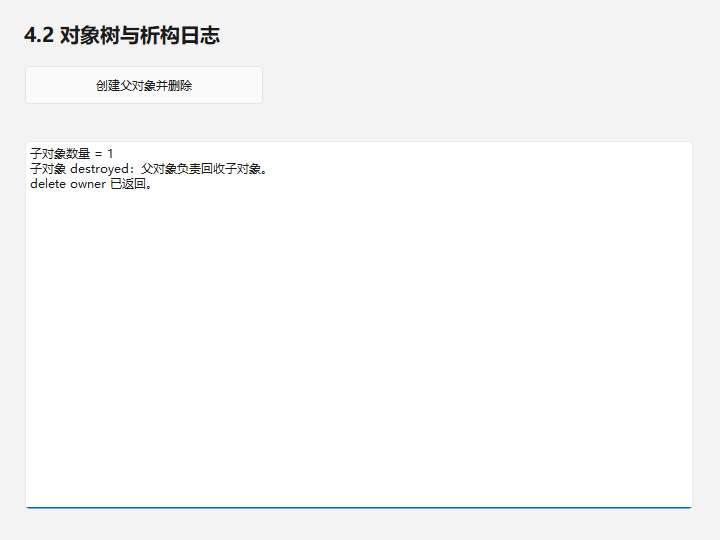

# 4.2 对象树的级联销毁

[教程中的本知识点](../../docs/knowledge/04_02_object_tree.md) · [第 4 章](../../docs/chapters/04-buttons.md)

### 本项目要掌握什么

对象树的级联销毁。这一节只围绕这个核心问题阅读和修改程序。

### 关键代码在哪里

关键片段 1：[ widget.cpp 第 11 行起](widget.cpp#L11)。以下代码从本项目源文件提取，完整上下文见源文件。

```cpp
connect(ui->runButton, &QPushButton::clicked, this,
        [this]()
        {
            auto *owner = new QObject(this);
            auto *child = new QObject(owner);
            connect(child, &QObject::destroyed, this,
                    [this]() { writeLine("子对象 destroyed：父对象负责回收子对象。"); });
            writeLine("子对象数量 = " + QString::number(owner->children().size()));
            delete owner; // 删除父对象，会删除 child；不要再访问 child
            writeLine("delete owner 已返回。");
        });
```

### 逐段讲解

owner 是窗口的子对象，child 又以 owner 为父对象。connect 只登记 destroyed 的处理函数，真正销毁发生在 delete owner。

删除 owner 会清理其仍存活的子对象，child 的 destroyed 信号让日志显示释放过程；局部指针离开作用域不会代替 delete。

### 按执行顺序阅读

构造函数先准备界面与连接；交互发生后才进入回调。阅读时按“发送对象 → 信号或调用 → 回调里的数据 → 被修改对象 → 显示结果”追踪，不要把建立连接当成已经执行操作。

### 容易出错的地方与动手验证

删除 owner 后不能再解引用 child，也不应再手动删除同一 child。观察子对象日志与 delete 返回日志的先后。

先写下预测，再修改一个条件重新构建。记录实际结果，并用本节代码中的变量、对象和调用顺序解释原因；仅仅没有报错不代表已经验证了所有分支。

### 运行结果



### 完整项目与界面文件

- [04_02_object_tree.pro](04_02_object_tree.pro)
- [main.cpp](main.cpp)
- [verify.h](verify.h)
- [widget.cpp](widget.cpp)
- [widget.h](widget.h)
- [widget.ui](widget.ui)

打开本项目 .pro，选择匹配的 Kit，构建运行；修改界面请打开 .ui，保存后重新构建。verify.h 只在传入 --verify 时执行检查。

## 在 Designer 中重做界面

从空白 Widgets 模板开始时，按下表拖入控件并设置相同的 objectName。已有完整 .ui 可直接使用；geometry 只适用于没有布局管理的控件。

### widget.ui

| objectName | 类型 | 主要设置 |
|---|---|---|
| `Widget` | QWidget | geometry=(0,0,720,540) |
| `headingLabel` | QLabel | geometry=(24,18,670,32)；text=04 对象树与析构日志 |
| `outputEdit` | QPlainTextEdit | geometry=(24,140,670,370)；readOnly=true |
| `runButton` | QPushButton | geometry=(24,65,240,40)；text=创建父对象并删除 |
