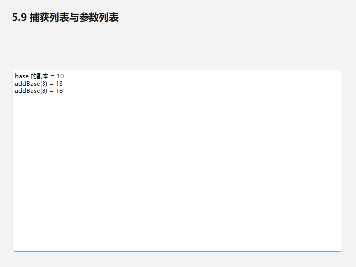

# 5.9 捕获值与函数参数的来源

[教程中的本知识点](../../docs/knowledge/05_09_capture_and_parameter.md) · [第 5 章](../../docs/chapters/05-signals-slots-lambda.md)

### 本项目要掌握什么

捕获值与函数参数的来源。这一节只围绕这个核心问题阅读和修改程序。

### 关键代码在哪里

关键片段 1：[ widget.cpp 第 11 行起](widget.cpp#L11)。以下代码从本项目源文件提取，完整上下文见源文件。

```cpp
int base = 10;
auto addBase = [base](int x) { return base + x; };
writeLine("base 的副本 = 10");
writeLine("addBase(3) = " + QString::number(addBase(3)));
writeLine("addBase(8) = " + QString::number(addBase(8)));
```

### 逐段讲解

base 在 Lambda 创建时按值捕获，为这个可调用对象保存一份 10；x 则来自每次调用 addBase 时提供的实参。

addBase(3) 与 addBase(8) 使用相同的 base 副本和不同的 x，因此得到 13 与 18。捕获列表不是函数的参数列表。

### 按执行顺序阅读

本项目的主要实验在构造函数里立即执行：变量初始化 → 定义或连接 → 显式调用 → 显示结果。先在代码中圈出实际调用位置，再区分哪些语句只是定义或登记行为。

### 容易出错的地方与动手验证

在定义后把外部 base 改为 100，预测两次结果；不要把每次传入的参数写进捕获列表代替它。

先写下预测，再修改一个条件重新构建。记录实际结果，并用本节代码中的变量、对象和调用顺序解释原因；仅仅没有报错不代表已经验证了所有分支。

### 运行结果



### 完整项目与界面文件

- [05_09_capture_and_parameter.pro](05_09_capture_and_parameter.pro)
- [main.cpp](main.cpp)
- [verify.h](verify.h)
- [widget.cpp](widget.cpp)
- [widget.h](widget.h)
- [widget.ui](widget.ui)

打开本项目 .pro，选择匹配的 Kit，构建运行；修改界面请打开 .ui，保存后重新构建。verify.h 只在传入 --verify 时执行检查。

## 在 Designer 中重做界面

从空白 Widgets 模板开始时，按下表拖入控件并设置相同的 objectName。已有完整 .ui 可直接使用；geometry 只适用于没有布局管理的控件。

### widget.ui

| objectName | 类型 | 主要设置 |
|---|---|---|
| `Widget` | QWidget | geometry=(0,0,720,540) |
| `headingLabel` | QLabel | geometry=(24,18,670,32)；text=14 捕获列表与参数列表 |
| `outputEdit` | QPlainTextEdit | geometry=(24,140,670,370)；readOnly=true |
