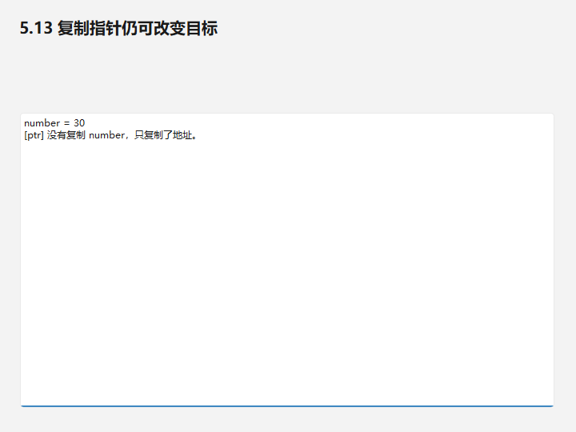

# 5.13 指针捕获复制地址

[教程中的本知识点](../../docs/knowledge/05_13_pointer_capture.md) · [第 5 章](../../docs/chapters/05-signals-slots-lambda.md)

### 本项目要掌握什么

指针捕获复制地址。这一节只围绕这个核心问题阅读和修改程序。

### 关键代码在哪里

关键片段 1：[ widget.cpp 第 11 行起](widget.cpp#L11)。以下代码从本项目源文件提取，完整上下文见源文件。

```cpp
int number = 10;
int *ptr = &number;
auto change = [ptr]() { *ptr = 30; };
change();
writeLine("number = " + QString::number(number));
writeLine("[ptr] 没有复制 number，只复制了地址。");
```

### 逐段讲解

ptr 指向 number，[ptr] 复制的是指针值。副本仍指向同一个 number，所以 *ptr=30 会改变外部整数。

这没有复制整个目标对象，也不延长目标对象的生命周期；本例立即调用，number 尚未离开作用域。

### 按执行顺序阅读

本项目的主要实验在构造函数里立即执行：变量初始化 → 定义或连接 → 显式调用 → 显示结果。先在代码中圈出实际调用位置，再区分哪些语句只是定义或登记行为。

### 容易出错的地方与动手验证

比较 ptr=nullptr 与 *ptr=30 的含义；指针不空也不能证明目标仍然存活。

先写下预测，再修改一个条件重新构建。记录实际结果，并用本节代码中的变量、对象和调用顺序解释原因；仅仅没有报错不代表已经验证了所有分支。

### 运行结果



### 完整项目与界面文件

- [05_13_pointer_capture.pro](05_13_pointer_capture.pro)
- [main.cpp](main.cpp)
- [verify.h](verify.h)
- [widget.cpp](widget.cpp)
- [widget.h](widget.h)
- [widget.ui](widget.ui)

打开本项目 .pro，选择匹配的 Kit，构建运行；修改界面请打开 .ui，保存后重新构建。verify.h 只在传入 --verify 时执行检查。

## 在 Designer 中重做界面

从空白 Widgets 模板开始时，按下表拖入控件并设置相同的 objectName。已有完整 .ui 可直接使用；geometry 只适用于没有布局管理的控件。

### widget.ui

| objectName | 类型 | 主要设置 |
|---|---|---|
| `Widget` | QWidget | geometry=(0,0,720,540) |
| `headingLabel` | QLabel | geometry=(24,18,670,32)；text=18 复制指针仍可改变目标 |
| `outputEdit` | QPlainTextEdit | geometry=(24,140,670,370)；readOnly=true |
