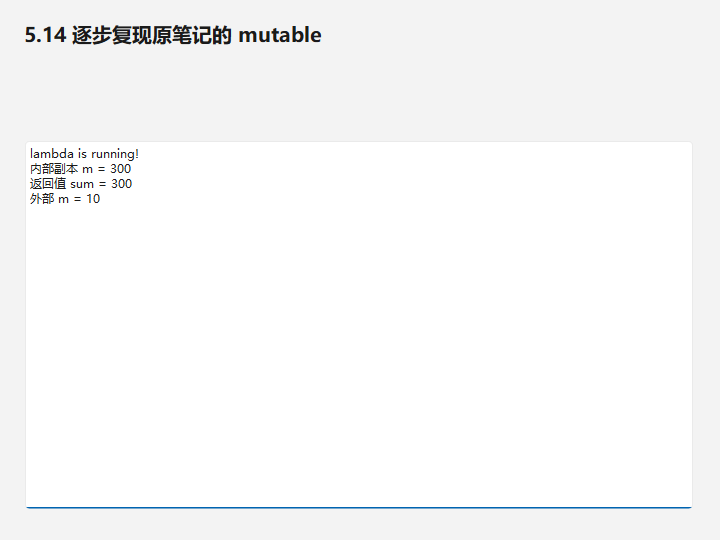

# 5.14 mutable修改捕获副本

[教程中的本知识点](../../docs/knowledge/05_14_mutable_original.md) · [第 5 章](../../docs/chapters/05-signals-slots-lambda.md)

### 本项目要掌握什么

mutable修改捕获副本。这一节只围绕这个核心问题阅读和修改程序。

### 关键代码在哪里

关键片段 1：[ widget.cpp 第 11 行起](widget.cpp#L11)。以下代码从本项目源文件提取，完整上下文见源文件。

```cpp
int m = 10;
auto fun = [m, this](int a, int b) mutable
{
    writeLine("lambda is running!");
    m = 300;
    writeLine("内部副本 m = " + QString::number(m));
    return a + b;
};
int sum = fun(100, 200);
writeLine("返回值 sum = " + QString::number(sum));
writeLine("外部 m = " + QString::number(m));
```

### 逐段讲解

[m,this] 复制 m 并保存 this 指针。mutable 允许函数体给自己的 m 副本赋值 300；它没有让外部 m 变成引用。

fun(100,200) 执行日志和副本赋值，再返回 a+b=300。内部副本 300、返回值 300 与外部 m=10 是三件不同的事。

### 按执行顺序阅读

本项目的主要实验在构造函数里立即执行：变量初始化 → 定义或连接 → 显式调用 → 显示结果。先在代码中圈出实际调用位置，再区分哪些语句只是定义或登记行为。

### 容易出错的地方与动手验证

把返回表达式改为 m，再区分返回值与外部状态；不要把 mutable 记成允许修改所有外部变量。

先写下预测，再修改一个条件重新构建。记录实际结果，并用本节代码中的变量、对象和调用顺序解释原因；仅仅没有报错不代表已经验证了所有分支。

### 运行结果



### 完整项目与界面文件

- [05_14_mutable_original.pro](05_14_mutable_original.pro)
- [main.cpp](main.cpp)
- [verify.h](verify.h)
- [widget.cpp](widget.cpp)
- [widget.h](widget.h)
- [widget.ui](widget.ui)

打开本项目 .pro，选择匹配的 Kit，构建运行；修改界面请打开 .ui，保存后重新构建。verify.h 只在传入 --verify 时执行检查。

## 在 Designer 中重做界面

从空白 Widgets 模板开始时，按下表拖入控件并设置相同的 objectName。已有完整 .ui 可直接使用；geometry 只适用于没有布局管理的控件。

### widget.ui

| objectName | 类型 | 主要设置 |
|---|---|---|
| `Widget` | QWidget | geometry=(0,0,720,540) |
| `headingLabel` | QLabel | geometry=(24,18,670,32)；text=19 逐步复现原笔记的 mutable |
| `outputEdit` | QPlainTextEdit | geometry=(24,140,670,370)；readOnly=true |
