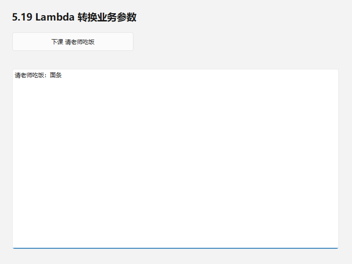

# 5.19 Lambda适配业务参数

[教程中的本知识点](../../docs/knowledge/05_19_lambda_adapter.md) · [第 5 章](../../docs/chapters/05-signals-slots-lambda.md)

### 本项目要掌握什么

Lambda适配业务参数。这一节只围绕这个核心问题阅读和修改程序。

### 关键代码在哪里

关键片段 1：[ widget.cpp 第 13 行起](widget.cpp#L13)。以下代码从本项目源文件提取，完整上下文见源文件。

```cpp
auto *teacher = new Teacher(this);
auto *student = new Student(this);
connect(student, &Student::message, this, &Widget::writeLine);
connect(teacher, qOverload<const QString &>(&Teacher::hungry), student,
        qOverload<const QString &>(&Student::treat));
connect(ui->runButton, &QPushButton::clicked, this,
        [teacher]() { teacher->requestFood(QStringLiteral("面条")); });
```

### 逐段讲解

clicked 的 bool 不是老师想要的菜名。Lambda 不声明 bool 参数，因此忽略它，改为显式调用 requestFood("面条")。

teacher 按值捕获仅复制地址，Student 的处理仍由 hungry(food) 触发。窗口 context 管理本连接，teacher 也作为窗口子对象管理。

### 按执行顺序阅读

构造函数先准备界面与连接；交互发生后才进入回调。阅读时按“发送对象 → 信号或调用 → 回调里的数据 → 被修改对象 → 显示结果”追踪，不要把建立连接当成已经执行操作。

### 容易出错的地方与动手验证

让按钮选择两种菜名再调用同一接口；若允许提前删除 teacher，需要另外检查其存活状态。

先写下预测，再修改一个条件重新构建。记录实际结果，并用本节代码中的变量、对象和调用顺序解释原因；仅仅没有报错不代表已经验证了所有分支。

### 运行结果



### 完整项目与界面文件

- [05_19_lambda_adapter.pro](05_19_lambda_adapter.pro)
- [main.cpp](main.cpp)
- [student.h](student.h)
- [teacher.h](teacher.h)
- [verify.h](verify.h)
- [widget.cpp](widget.cpp)
- [widget.h](widget.h)
- [widget.ui](widget.ui)

打开本项目 .pro，选择匹配的 Kit，构建运行；修改界面请打开 .ui，保存后重新构建。verify.h 只在传入 --verify 时执行检查。

## 在 Designer 中重做界面

从空白 Widgets 模板开始时，按下表拖入控件并设置相同的 objectName。已有完整 .ui 可直接使用；geometry 只适用于没有布局管理的控件。

### widget.ui

| objectName | 类型 | 主要设置 |
|---|---|---|
| `Widget` | QWidget | geometry=(0,0,720,540) |
| `headingLabel` | QLabel | geometry=(24,18,670,32)；text=24 Lambda 转换业务参数 |
| `outputEdit` | QPlainTextEdit | geometry=(24,140,670,370)；readOnly=true |
| `runButton` | QPushButton | geometry=(24,65,250,40)；text=下课 请老师吃饭 |
