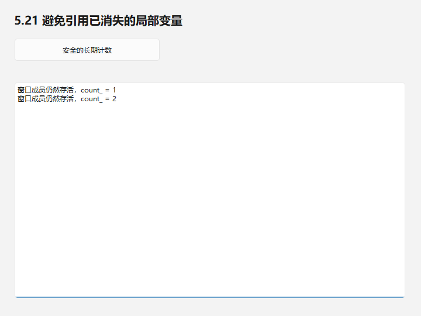

# 5.21 长期回调使用窗口状态

[教程中的本知识点](../../docs/knowledge/05_21_safe_delayed_state.md) · [第 5 章](../../docs/chapters/05-signals-slots-lambda.md)

### 本项目要掌握什么

长期回调使用窗口状态。这一节只围绕这个核心问题阅读和修改程序。

### 关键代码在哪里

关键片段 1：[ widget.cpp 第 11 行起](widget.cpp#L11)。以下代码从本项目源文件提取，完整上下文见源文件。

```cpp
// 错误思路（仅说明，不执行）：
// int localCount = 0;
// 把 [&localCount] 保存到按钮回调，构造结束后引用就会失效。
connect(ui->runButton, &QPushButton::clicked, this,
        [this]()
        {
            ++count_;
            writeLine("窗口成员仍然存活，count_ = " + QString::number(count_));
        });
```

### 逐段讲解

注释中的 localCount 是错误思路：构造结束后局部变量消失，保存它的引用不能安全等到点击。

实际代码把 count_ 保存在窗口成员中，用 [this] 更新，并以窗口为 context。只要该窗口回调仍在正常工作，成员状态就有明确归属。

### 按执行顺序阅读

构造函数先准备界面与连接；交互发生后才进入回调。阅读时按“发送对象 → 信号或调用 → 回调里的数据 → 被修改对象 → 显示结果”追踪，不要把建立连接当成已经执行操作。

### 容易出错的地方与动手验证

多次点击观察连续计数，再解释为什么复制裸指针也不等于延长目标生命周期。

先写下预测，再修改一个条件重新构建。记录实际结果，并用本节代码中的变量、对象和调用顺序解释原因；仅仅没有报错不代表已经验证了所有分支。

### 运行结果



### 完整项目与界面文件

- [05_21_safe_delayed_state.pro](05_21_safe_delayed_state.pro)
- [main.cpp](main.cpp)
- [verify.h](verify.h)
- [widget.cpp](widget.cpp)
- [widget.h](widget.h)
- [widget.ui](widget.ui)

打开本项目 .pro，选择匹配的 Kit，构建运行；修改界面请打开 .ui，保存后重新构建。verify.h 只在传入 --verify 时执行检查。

## 在 Designer 中重做界面

从空白 Widgets 模板开始时，按下表拖入控件并设置相同的 objectName。已有完整 .ui 可直接使用；geometry 只适用于没有布局管理的控件。

### widget.ui

| objectName | 类型 | 主要设置 |
|---|---|---|
| `Widget` | QWidget | geometry=(0,0,720,540) |
| `headingLabel` | QLabel | geometry=(24,18,670,32)；text=26 避免引用已消失的局部变量 |
| `outputEdit` | QPlainTextEdit | geometry=(24,140,670,370)；readOnly=true |
| `runButton` | QPushButton | geometry=(24,65,250,40)；text=安全的长期计数 |
