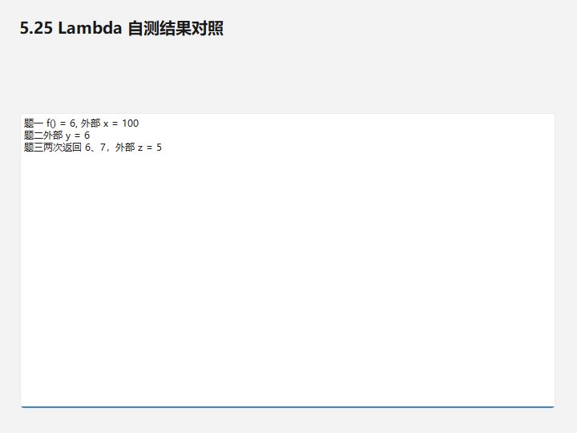

# 5.25 用输出验证捕获规则

[教程中的本知识点](../../docs/knowledge/05_25_self_test.md) · [第 5 章](../../docs/chapters/05-signals-slots-lambda.md)

### 本项目要掌握什么

用输出验证捕获规则。这一节只围绕这个核心问题阅读和修改程序。

### 关键代码在哪里

关键片段 1：[ widget.cpp 第 11 行起](widget.cpp#L11)。以下代码从本项目源文件提取，完整上下文见源文件。

```cpp
int x = 5;
auto value = [x]() { return x + 1; };
x = 100;
writeLine("题一 f() = " + QString::number(value()) + ", 外部 x = " + QString::number(x));
int y = 5;
auto reference = [&y]() { ++y; };
reference();
writeLine("题二外部 y = " + QString::number(y));
int z = 5;
auto state = [z]() mutable { return ++z; };
int first = state();
int second = state();
writeLine(QString("题三两次返回 %1、%2，外部 z = %3").arg(first).arg(second).arg(z));
```

### 逐段讲解

第一组按值保存 x=5，外部改到 100 后仍返回 6；第二组按引用修改 y，结果 6；第三组 mutable 连续更新 z 副本，返回 6、7，外部仍为 5。

这些都是立即执行的纯 C++ 捕获实验，先逐组判断访问哪个对象，再把相同判断方法用于按钮回调。

### 按执行顺序阅读

本项目的主要实验在构造函数里立即执行：变量初始化 → 定义或连接 → 显式调用 → 显示结果。先在代码中圈出实际调用位置，再区分哪些语句只是定义或登记行为。

### 容易出错的地方与动手验证

先遮住结果写出预测和理由，再运行；输出相同的数字也可能来自不同状态，不能只背结果。

先写下预测，再修改一个条件重新构建。记录实际结果，并用本节代码中的变量、对象和调用顺序解释原因；仅仅没有报错不代表已经验证了所有分支。

### 运行结果



### 完整项目与界面文件

- [05_25_self_test.pro](05_25_self_test.pro)
- [main.cpp](main.cpp)
- [verify.h](verify.h)
- [widget.cpp](widget.cpp)
- [widget.h](widget.h)
- [widget.ui](widget.ui)

打开本项目 .pro，选择匹配的 Kit，构建运行；修改界面请打开 .ui，保存后重新构建。verify.h 只在传入 --verify 时执行检查。

## 在 Designer 中重做界面

从空白 Widgets 模板开始时，按下表拖入控件并设置相同的 objectName。已有完整 .ui 可直接使用；geometry 只适用于没有布局管理的控件。

### widget.ui

| objectName | 类型 | 主要设置 |
|---|---|---|
| `Widget` | QWidget | geometry=(0,0,720,540) |
| `headingLabel` | QLabel | geometry=(24,18,670,32)；text=30 Lambda 自测结果对照 |
| `outputEdit` | QPlainTextEdit | geometry=(24,140,670,370)；readOnly=true |
