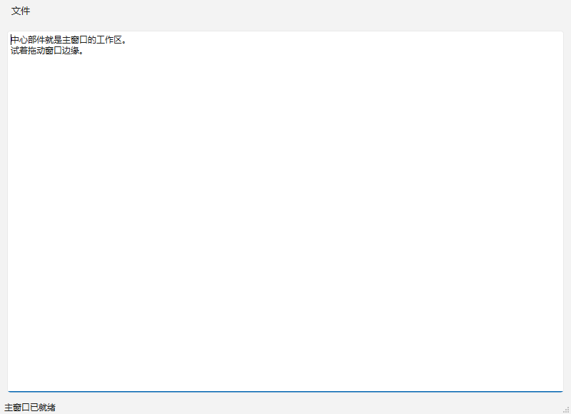

# 6.1 QMainWindow中心工作区

[教程中的本知识点](../../docs/knowledge/06_01_mainwindow.md) · [第 6 章](../../docs/chapters/06-mainwindow.md)

### 本项目要掌握什么

QMainWindow中心工作区。这一节只围绕这个核心问题阅读和修改程序。

### 关键代码在哪里

关键片段 1：[ mainwindow.ui 第 16 行起](mainwindow.ui#L16)。以下是相关界面 XML 节选，完整表单保留在项目中。

```xml
  <widget class="QWidget" name="centralwidget">
   <layout class="QVBoxLayout" name="verticalLayout">
    <item>
     <widget class="QTextEdit" name="textEdit">
      <property name="plainText">
       <string>中心部件就是主窗口的工作区。
试着拖动窗口边缘。</string>
      </property>
     </widget>
    </item>
   </layout>
  </widget>
  <widget class="QMenuBar" name="menubar">
   <widget class="QMenu" name="menuFile">
    <property name="title">
     <string>文件</string>
    </property>
   </widget>
   <addaction name="menuFile" />
  </widget>
  <widget class="QStatusBar" name="statusbar" />
 </widget>
 <resources />
 <connections />
</ui>
```

### 逐段讲解

mainwindow.ui 建立 centralwidget、布局和 textEdit，setupUi 内部把工作区交给主窗口管理。构造函数只需设置状态提示。

主窗口自带菜单、工具栏、停靠和状态栏区域，不能把普通 QWidget 的任意布局直接装到 QMainWindow 顶层。

### 按执行顺序阅读

先从 main.cpp 创建应用和窗口进入构造函数，再由 setupUi 根据 .ui 建立对象、属性与布局。对照上面的片段定位本节设置；show 后进入事件循环，界面才会持续响应操作。

### 容易出错的地方与动手验证

在 centralwidget 布局里增加标签，缩放观察工作区；到 .ui 查看对象层级，区分被创建与被正确放置。

先写下预测，再修改一个条件重新构建。记录实际结果，并用本节代码中的变量、对象和调用顺序解释原因；仅仅没有报错不代表已经验证了所有分支。

### 运行结果



### 完整项目与界面文件

- [06_01_mainwindow.pro](06_01_mainwindow.pro)
- [main.cpp](main.cpp)
- [mainwindow.cpp](mainwindow.cpp)
- [mainwindow.h](mainwindow.h)
- [mainwindow.ui](mainwindow.ui)
- [verify.h](verify.h)

打开本项目 .pro，选择匹配的 Kit，构建运行；修改界面请打开 .ui，保存后重新构建。verify.h 只在传入 --verify 时执行检查。

## 在 Designer 中重做界面

从空白 Widgets 模板开始时，按下表拖入控件并设置相同的 objectName。已有完整 .ui 可直接使用；geometry 只适用于没有布局管理的控件。

### mainwindow.ui

| objectName | 类型 | 主要设置 |
|---|---|---|
| `MainWindow` | QMainWindow | geometry=(0,0,800,580) |
| `centralwidget` | QWidget | 按 .ui 中的默认属性 |
| `textEdit` | QTextEdit | plainText=中心部件就是主窗口的工作区。 / 试着拖动窗口边缘。 |
| `menubar` | QMenuBar | 按 .ui 中的默认属性 |
| `menuFile` | QMenu | 按 .ui 中的默认属性 |
| `statusbar` | QStatusBar | 按 .ui 中的默认属性 |
| `verticalLayout` | QVBoxLayout | 布局内的控件交给布局分配空间 |
