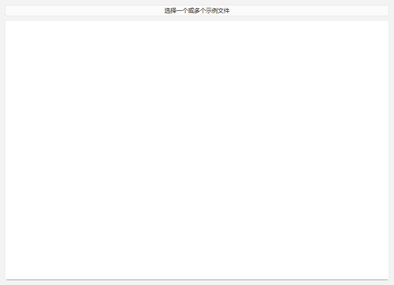

# 7.3 文件选择与取消处理

[教程中的本知识点](../../docs/knowledge/07_03_file_dialog.md) · [第 7 章](../../docs/chapters/07-dialogs.md)

### 本项目要掌握什么

文件选择与取消处理。这一节只围绕这个核心问题阅读和修改程序。

### 关键代码在哪里

关键片段 1：[ mainwindow.cpp 第 11 行起](mainwindow.cpp#L11)。以下代码从本项目源文件提取，完整上下文见源文件。

```cpp
connect(ui->run, &QPushButton::clicked, this,
        [this]()
        {
            auto *dialog = new QFileDialog(this, "选择文件",
                                           QStringLiteral(QT_LESSON_SOURCE_DIR "/samples"));
            dialog->setOption(QFileDialog::DontUseNativeDialog);
            dialog->setFileMode(QFileDialog::ExistingFiles);
            dialog->setNameFilter("Text (*.txt);;Images (*.png *.jpg)");
            dialog->setAttribute(Qt::WA_DeleteOnClose);
            connect(dialog, &QFileDialog::filesSelected, ui->resultEdit,
                    [this](const QStringList &files)
                    { ui->resultEdit->setPlainText(files.join('\n')); });
            dialog->open();
        });
```

### 逐段讲解

QFileDialog 先设置 ExistingFiles 和过滤器，再连接 filesSelected，最后 open；只有完成文件选择时才把路径列表写入结果框。

过滤器只是帮助筛选文件，取消不执行选择逻辑。当前示例选择路径，不读取文件内容；读取与安全保存由后面的文本编辑器承担。

### 关键分支再拆一步

构造 QFileDialog 只准备选择过程，ExistingFiles 允许多个现有文件，nameFilter 只设置筛选规则。filesSelected 的 QStringList 是确认选择后的结果；join 将多条路径逐行显示。取消不会发出成功选择的这段处理，文件内容仍需另外用 QFile 打开。

### 按执行顺序阅读

构造函数先准备界面与连接；交互发生后才进入回调。阅读时按“发送对象 → 信号或调用 → 回调里的数据 → 被修改对象 → 显示结果”追踪，不要把建立连接当成已经执行操作。

### 容易出错的地方与动手验证

先取消再选一个或多个文件，比较结果；不要把相对路径的基准误认为源码目录。

先写下预测，再修改一个条件重新构建。记录实际结果，并用本节代码中的变量、对象和调用顺序解释原因；仅仅没有报错不代表已经验证了所有分支。

### 运行结果



### 完整项目与界面文件

- [07_03_file_dialog.pro](07_03_file_dialog.pro)
- [main.cpp](main.cpp)
- [mainwindow.cpp](mainwindow.cpp)
- [mainwindow.h](mainwindow.h)
- [mainwindow.ui](mainwindow.ui)
- [verify.h](verify.h)

打开本项目 .pro，选择匹配的 Kit，构建运行；修改界面请打开 .ui，保存后重新构建。verify.h 只在传入 --verify 时执行检查。

## 在 Designer 中重做界面

从空白 Widgets 模板开始时，按下表拖入控件并设置相同的 objectName。已有完整 .ui 可直接使用；geometry 只适用于没有布局管理的控件。

### mainwindow.ui

| objectName | 类型 | 主要设置 |
|---|---|---|
| `MainWindow` | QMainWindow | geometry=(0,0,800,580) |
| `centralwidget` | QWidget | 按 .ui 中的默认属性 |
| `run` | QPushButton | text=选择一个或多个示例文件 |
| `resultEdit` | QTextEdit | readOnly=true |
| `verticalLayout` | QVBoxLayout | 布局内的控件交给布局分配空间 |
