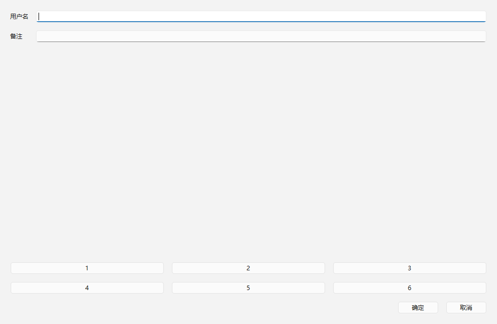

# 8.1 四种布局的嵌套

[教程中的本知识点](../../docs/knowledge/08_01_layout.md) · [第 8 章](../../docs/chapters/08-layouts.md)

### 本项目要掌握什么

四种布局的嵌套。这一节只围绕这个核心问题阅读和修改程序。

### 关键代码在哪里

关键片段 1：[ mainwindow.ui 第 16 行起](mainwindow.ui#L16)。以下是相关界面 XML 节选，完整表单保留在项目中。

```xml
  <widget class="QWidget" name="centralwidget">
   <layout class="QVBoxLayout" name="verticalLayout">
    <item>
     <layout class="QFormLayout" name="formLayout">
      <item row="0" column="0">
       <widget class="QLabel" name="nameEditLabel">
        <property name="text">
         <string>用户名</string>
        </property>
       </widget>
      </item>
      <item row="0" column="1">
       <widget class="QLineEdit" name="nameEdit" />
      </item>
      <item row="1" column="0">
       <widget class="QLabel" name="noteEditLabel">
        <property name="text">
         <string>备注</string>
        </property>
       </widget>
      </item>
      <item row="1" column="1">
       <widget class="QLineEdit" name="noteEdit" />
      </item>
     </layout>
    </item>
    <item>
     <layout class="QGridLayout" name="gridLayout">
      <item row="0" column="0">
       <widget class="QPushButton" name="number1">
        <property name="text">
         <string>1</string>
        </property>
       </widget>
      </item>
```

### 逐段讲解

mainwindow.ui 中 verticalLayout 依次管理 formLayout、gridLayout 和 buttonLayout；form 的行列配对标签与输入，grid 排列六个按钮。

底部水平布局的 spacer 吸收空余空间，外层 margins 与 spacing 控制留白。窗口尺寸变化后，布局根据约束重新分配位置。

### 按执行顺序阅读

先从 main.cpp 创建应用和窗口进入构造函数，再由 setupUi 根据 .ui 建立对象、属性与布局。对照上面的片段定位本节设置；show 后进入事件循环，界面才会持续响应操作。

### 容易出错的地方与动手验证

逐项修改 spacing、边距与 stretch，再试固定按钮大小；不要同时用布局和 move 强行控制同一位置。

先写下预测，再修改一个条件重新构建。记录实际结果，并用本节代码中的变量、对象和调用顺序解释原因；仅仅没有报错不代表已经验证了所有分支。

### 运行结果



### 完整项目与界面文件

- [08_01_layout.pro](08_01_layout.pro)
- [main.cpp](main.cpp)
- [mainwindow.cpp](mainwindow.cpp)
- [mainwindow.h](mainwindow.h)
- [mainwindow.ui](mainwindow.ui)
- [verify.h](verify.h)

打开本项目 .pro，选择匹配的 Kit，构建运行；修改界面请打开 .ui，保存后重新构建。verify.h 只在传入 --verify 时执行检查。

## 在 Designer 中重做界面

从空白 Widgets 模板开始时，按下表拖入控件并设置相同的 objectName。已有完整 .ui 可直接使用；geometry 只适用于没有布局管理的控件。

### mainwindow.ui

| objectName | 类型 | 主要设置 |
|---|---|---|
| `MainWindow` | QMainWindow | geometry=(0,0,800,580) |
| `centralwidget` | QWidget | 按 .ui 中的默认属性 |
| `nameEditLabel` | QLabel | text=用户名 |
| `nameEdit` | QLineEdit | 按 .ui 中的默认属性 |
| `noteEditLabel` | QLabel | text=备注 |
| `noteEdit` | QLineEdit | 按 .ui 中的默认属性 |
| `number1` | QPushButton | text=1 |
| `number2` | QPushButton | text=2 |
| `number3` | QPushButton | text=3 |
| `number4` | QPushButton | text=4 |
| `number5` | QPushButton | text=5 |
| `number6` | QPushButton | text=6 |
| `okButton` | QPushButton | text=确定 |
| `cancelButton` | QPushButton | text=取消 |
| `verticalLayout` | QVBoxLayout | 布局内的控件交给布局分配空间 |
| `formLayout` | QFormLayout | 布局内的控件交给布局分配空间 |
| `gridLayout` | QGridLayout | 布局内的控件交给布局分配空间 |
| `buttonLayout` | QHBoxLayout | 布局内的控件交给布局分配空间 |
