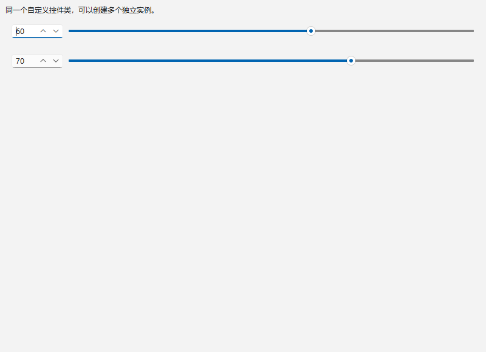

# 9.3 可复用组合控件与提升

[教程中的本知识点](../../docs/knowledge/09_03_custom_widget.md) · [第 9 章](../../docs/chapters/09-widgets.md)

### 本项目要掌握什么

可复用组合控件与提升。这一节只围绕这个核心问题阅读和修改程序。

### 关键代码在哪里

关键片段 1：[ smallwidget.cpp 第 4 行起](smallwidget.cpp#L4)。以下代码从本项目源文件提取，完整上下文见源文件。

```cpp
SmallWidget::SmallWidget(QWidget *parent)
    : QWidget(parent)
    , ui(new Ui::SmallWidget)
{
    ui->setupUi(this);
    connect(ui->spinBox, &QSpinBox::valueChanged, ui->horizontalSlider, &QSlider::setValue);
    connect(ui->horizontalSlider, &QSlider::valueChanged, ui->spinBox, &QSpinBox::setValue);
}
```

关键片段 2：[ smallwidget.cpp 第 18 行起](smallwidget.cpp#L18)。以下代码从本项目源文件提取，完整上下文见源文件。

```cpp
void SmallWidget::setValue(int value)
{
    ui->spinBox->setValue(value);
}
```

关键片段 3：[ smallwidget.cpp 第 23 行起](smallwidget.cpp#L23)。以下代码从本项目源文件提取，完整上下文见源文件。

```cpp
int SmallWidget::value() const
{
    return ui->spinBox->value();
}
```

### 逐段讲解

mainwindow.ui 的 first、second 提升为 SmallWidget；每个实例的 smallwidget.ui 分别创建 SpinBox 和 Slider。

双向连接把两个值同步起来，setValue/value 提供对外接口；相同值不再重复触发变化，使本例同步能稳定结束。

### 关键分支再拆一步

外层 first 与 second 的 Ui 指针、SpinBox 和 Slider 都分别创建。SmallWidget::setValue 只调用内部 SpinBox 的 setter，后者通过 valueChanged 推动 Slider；Slider 再通知 SpinBox 时值已相同，标准控件不会无限重复发送相同变化。自己的组件也应建立这种值变化约束。

### 按执行顺序阅读

构造函数先准备界面与连接；交互发生后才进入回调。阅读时按“发送对象 → 信号或调用 → 回调里的数据 → 被修改对象 → 显示结果”追踪，不要把建立连接当成已经执行操作。

### 容易出错的地方与动手验证

改变第一个实例确认第二个不变；自己的 setter 若每次都无条件发信号，可能需要先比较值或用 QSignalBlocker。

先写下预测，再修改一个条件重新构建。记录实际结果，并用本节代码中的变量、对象和调用顺序解释原因；仅仅没有报错不代表已经验证了所有分支。

### 运行结果



### 完整项目与界面文件

- [09_03_custom_widget.pro](09_03_custom_widget.pro)
- [main.cpp](main.cpp)
- [mainwindow.cpp](mainwindow.cpp)
- [mainwindow.h](mainwindow.h)
- [mainwindow.ui](mainwindow.ui)
- [smallwidget.cpp](smallwidget.cpp)
- [smallwidget.h](smallwidget.h)
- [smallwidget.ui](smallwidget.ui)
- [verify.h](verify.h)

打开本项目 .pro，选择匹配的 Kit，构建运行；修改界面请打开 .ui，保存后重新构建。verify.h 只在传入 --verify 时执行检查。

## 在 Designer 中重做界面

从空白 Widgets 模板开始时，按下表拖入控件并设置相同的 objectName。已有完整 .ui 可直接使用；geometry 只适用于没有布局管理的控件。

### mainwindow.ui

| objectName | 类型 | 主要设置 |
|---|---|---|
| `MainWindow` | QMainWindow | geometry=(0,0,800,580) |
| `centralwidget` | QWidget | 按 .ui 中的默认属性 |
| `hintLabel` | QLabel | text=同一个自定义控件类，可以创建多个独立实例。 |
| `first` | SmallWidget | 按 .ui 中的默认属性 |
| `second` | SmallWidget | 按 .ui 中的默认属性 |
| `verticalLayout` | QVBoxLayout | 布局内的控件交给布局分配空间 |

提升设置：将 QWidget 提升为 **SmallWidget**，头文件填写 `smallwidget.h`。

### smallwidget.ui

| objectName | 类型 | 主要设置 |
|---|---|---|
| `SmallWidget` | QWidget | geometry=(0,0,500,80) |
| `spinBox` | QSpinBox | maximum=100 |
| `horizontalSlider` | QSlider | orientation=Qt::Horizontal；maximum=100 |
| `horizontalLayout` | QHBoxLayout | 布局内的控件交给布局分配空间 |
