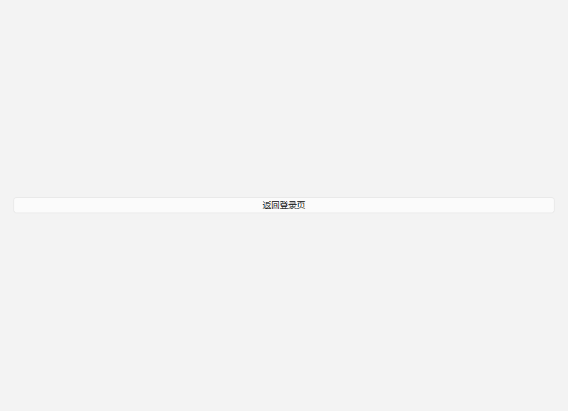

# 9.4 堆叠页面与状态保留

[教程中的本知识点](../../docs/knowledge/09_04_stacked_pages.md) · [第 9 章](../../docs/chapters/09-widgets.md)

### 本项目要掌握什么

堆叠页面与状态保留。这一节只围绕这个核心问题阅读和修改程序。

### 关键代码在哪里

关键片段 1：[ mainwindow.cpp 第 11 行起](mainwindow.cpp#L11)。以下代码从本项目源文件提取，完整上下文见源文件。

```cpp
connect(ui->run, &QPushButton::clicked, this, [this]() { ui->pages->setCurrentIndex(1); });
connect(ui->back, &QPushButton::clicked, this, [this]() { ui->pages->setCurrentIndex(0); });
```

### 逐段讲解

pages 包含 loginPage、homePage，按钮回调只调用 setCurrentIndex，索引从 0 开始。

切换显示不会重新创建另一页，也不会自动清空输入或完成身份校验；所有页面仍由同一窗口管理。

### 按执行顺序阅读

构造函数先准备界面与连接；交互发生后才进入回调。阅读时按“发送对象 → 信号或调用 → 回调里的数据 → 被修改对象 → 显示结果”追踪，不要把建立连接当成已经执行操作。

### 容易出错的地方与动手验证

在页面加输入框，往返后观察状态保留；removeWidget 不等于 delete，要另行决定对象释放。

先写下预测，再修改一个条件重新构建。记录实际结果，并用本节代码中的变量、对象和调用顺序解释原因；仅仅没有报错不代表已经验证了所有分支。

### 运行结果



### 完整项目与界面文件

- [09_04_stacked_pages.pro](09_04_stacked_pages.pro)
- [main.cpp](main.cpp)
- [mainwindow.cpp](mainwindow.cpp)
- [mainwindow.h](mainwindow.h)
- [mainwindow.ui](mainwindow.ui)
- [verify.h](verify.h)

打开本项目 .pro，选择匹配的 Kit，构建运行；修改界面请打开 .ui，保存后重新构建。verify.h 只在传入 --verify 时执行检查。

## 在 Designer 中重做界面

从空白 Widgets 模板开始时，按下表拖入控件并设置相同的 objectName。已有完整 .ui 可直接使用；geometry 只适用于没有布局管理的控件。

### mainwindow.ui

| objectName | 类型 | 主要设置 |
|---|---|---|
| `MainWindow` | QMainWindow | geometry=(0,0,800,580) |
| `centralwidget` | QWidget | 按 .ui 中的默认属性 |
| `pages` | QStackedWidget | currentIndex=0 |
| `loginPage` | QWidget | 按 .ui 中的默认属性 |
| `run` | QPushButton | text=进入主页（仅演示导航） |
| `homePage` | QWidget | 按 .ui 中的默认属性 |
| `back` | QPushButton | text=返回登录页 |
| `verticalLayout` | QVBoxLayout | 布局内的控件交给布局分配空间 |
| `loginPageLayout` | QVBoxLayout | 布局内的控件交给布局分配空间 |
| `homePageLayout` | QVBoxLayout | 布局内的控件交给布局分配空间 |
