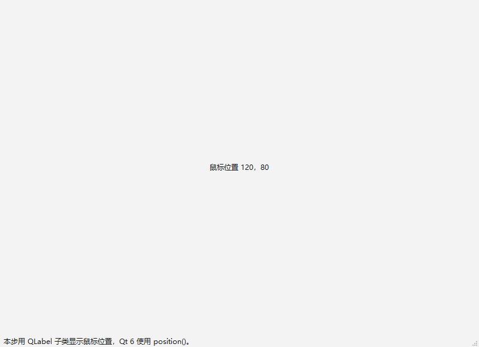

# 10.2 鼠标事件的坐标与按键

[教程中的本知识点](../../docs/knowledge/10_02_mouse_events.md) · [第 10 章](../../docs/chapters/10-events.md)

### 本项目要掌握什么

鼠标事件的坐标与按键。这一节只围绕这个核心问题阅读和修改程序。

### 关键代码在哪里

关键片段 1：[ eventarea.cpp 第 15 行起](eventarea.cpp#L15)。以下代码从本项目源文件提取，完整上下文见源文件。

```cpp
void EventArea::mouseMoveEvent(QMouseEvent *event)
{
    setText(QString("鼠标位置 %1，%2").arg(event->position().x()).arg(event->position().y()));
    QLabel::mouseMoveEvent(event);
}
```

关键片段 2：[ eventarea.cpp 第 21 行起](eventarea.cpp#L21)。以下代码从本项目源文件提取，完整上下文见源文件。

```cpp
void EventArea::mousePressEvent(QMouseEvent *event)
{
    setFocus();
    setText(event->button() == Qt::LeftButton ? "左键按下" : "其他鼠标键按下");
    QLabel::mousePressEvent(event);
}
```

### 逐段讲解

mouseMoveEvent 的 position 是相对当前 EventArea 的位置；mousePressEvent 的 button 表示本次发生变化的按键。

mouseTracking 使没有按键时也能收到移动事件；buttons 表示当前按下集合，与 button 不同。调用基类函数保留默认处理。

### 按执行顺序阅读

窗口初始化先准备对象和连接；用户输入、尺寸变化或重绘请求到达后，才进入上述处理函数。依次追踪事件或信号的目标、类型判断、状态变化和结果更新，再观察是否把剩余处理交回基类。

### 容易出错的地方与动手验证

比较悬停与按键拖动，并把区域移进布局；不要把控件坐标当作全屏坐标。

先写下预测，再修改一个条件重新构建。记录实际结果，并用本节代码中的变量、对象和调用顺序解释原因；仅仅没有报错不代表已经验证了所有分支。

### 运行结果



### 完整项目与界面文件

- [10_02_mouse_events.pro](10_02_mouse_events.pro)
- [eventarea.cpp](eventarea.cpp)
- [eventarea.h](eventarea.h)
- [main.cpp](main.cpp)
- [mainwindow.cpp](mainwindow.cpp)
- [mainwindow.h](mainwindow.h)
- [mainwindow.ui](mainwindow.ui)
- [verify.h](verify.h)

打开本项目 .pro，选择匹配的 Kit，构建运行；修改界面请打开 .ui，保存后重新构建。verify.h 只在传入 --verify 时执行检查。

## 在 Designer 中重做界面

从空白 Widgets 模板开始时，按下表拖入控件并设置相同的 objectName。已有完整 .ui 可直接使用；geometry 只适用于没有布局管理的控件。

### mainwindow.ui

| objectName | 类型 | 主要设置 |
|---|---|---|
| `MainWindow` | QMainWindow | geometry=(0,0,800,580) |
| `eventArea` | EventArea | 按 .ui 中的默认属性 |
| `statusbar` | QStatusBar | 按 .ui 中的默认属性 |

提升设置：将 QLabel 提升为 **EventArea**，头文件填写 `eventarea.h`。
