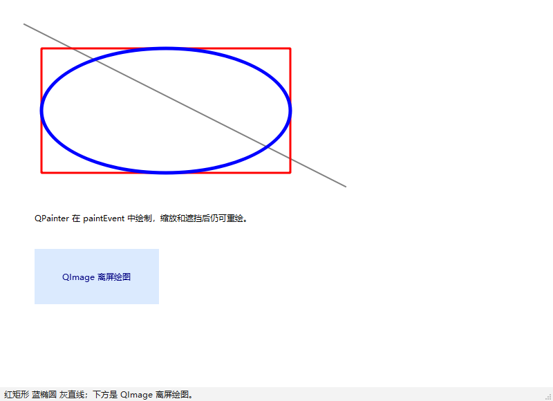

# 11.1 paintEvent与绘图设备

[教程中的本知识点](../../docs/knowledge/11_01_painter.md) · [第 11 章](../../docs/chapters/11-painting.md)

### 本项目要掌握什么

paintEvent与绘图设备。这一节只围绕这个核心问题阅读和修改程序。

### 关键代码在哪里

关键片段 1：[ canvas.cpp 第 9 行起](canvas.cpp#L9)。以下代码从本项目源文件提取，完整上下文见源文件。

```cpp
void Canvas::paintEvent(QPaintEvent *)
{
    QPainter painter(this);
    painter.setRenderHint(QPainter::Antialiasing);
    painter.fillRect(rect(), Qt::white);
    painter.setPen(QPen(Qt::darkGray, 2));
    painter.drawLine(35, 35, 500, 270);
    painter.setPen(QPen(Qt::red, 3));
    painter.drawRect(60, 70, 360, 180);
    painter.setPen(QPen(Qt::blue, 5));
    painter.drawEllipse(60, 70, 360, 180);
    painter.setPen(Qt::black);
    painter.drawText(50, 320, "QPainter 在 paintEvent 中绘制，缩放和遮挡后仍可重绘。");
    QImage image(180, 80, QImage::Format_ARGB32);
    image.fill(QColor("#dbeafe"));
    {
        QPainter imagePainter(&image);
        imagePainter.setPen(Qt::darkBlue);
        imagePainter.drawText(image.rect(), Qt::AlignCenter, "QImage 离屏绘图");
    }
    painter.drawImage(50, 360, image);
}
```

### 逐段讲解

QPainter 在 paintEvent 内绑定 Canvas，设置画笔后绘制线条、矩形、椭圆和文字；它是局部对象，函数退出时结束本次绘制。

QImage 是另一个绘图目标，内层作用域结束 imagePainter 后，再把图像画到窗口；设备、画笔状态和屏幕显示不是同一概念。

### 按执行顺序阅读

窗口初始化先准备对象和连接；用户输入、尺寸变化或重绘请求到达后，才进入上述处理函数。依次追踪事件或信号的目标、类型判断、状态变化和结果更新，再观察是否把剩余处理交回基类。

### 容易出错的地方与动手验证

缩放、遮挡后恢复观察重绘；不要保存长期活动的 QPainter，或只在按钮槽临时画一次就期望永久存在。

先写下预测，再修改一个条件重新构建。记录实际结果，并用本节代码中的变量、对象和调用顺序解释原因；仅仅没有报错不代表已经验证了所有分支。

### 运行结果



### 完整项目与界面文件

- [11_01_painter.pro](11_01_painter.pro)
- [canvas.cpp](canvas.cpp)
- [canvas.h](canvas.h)
- [main.cpp](main.cpp)
- [mainwindow.cpp](mainwindow.cpp)
- [mainwindow.h](mainwindow.h)
- [mainwindow.ui](mainwindow.ui)
- [verify.h](verify.h)

打开本项目 .pro，选择匹配的 Kit，构建运行；修改界面请打开 .ui，保存后重新构建。verify.h 只在传入 --verify 时执行检查。

## 在 Designer 中重做界面

从空白 Widgets 模板开始时，按下表拖入控件并设置相同的 objectName。已有完整 .ui 可直接使用；geometry 只适用于没有布局管理的控件。

### mainwindow.ui

| objectName | 类型 | 主要设置 |
|---|---|---|
| `MainWindow` | QMainWindow | geometry=(0,0,800,580) |
| `canvas` | Canvas | 按 .ui 中的默认属性 |
| `statusbar` | QStatusBar | 按 .ui 中的默认属性 |

提升设置：将 QWidget 提升为 **Canvas**，头文件填写 `canvas.h`。
