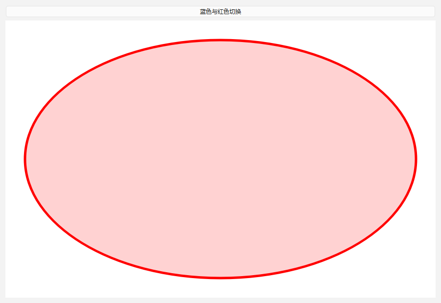

# 11.2 状态更新与重绘分离

[教程中的本知识点](../../docs/knowledge/11_02_interactive_paint.md) · [第 11 章](../../docs/chapters/11-painting.md)

### 本项目要掌握什么

状态更新与重绘分离。这一节只围绕这个核心问题阅读和修改程序。

### 关键代码在哪里

关键片段 1：[ widget.cpp 第 6 行起](widget.cpp#L6)。以下代码从本项目源文件提取，完整上下文见源文件。

```cpp
Widget::Widget(QWidget *parent)
    : QWidget(parent)
    , ui(new Ui::Widget)
{
    ui->setupUi(this);
    connect(ui->toggleButton, &QPushButton::clicked, this,
            [this]()
            {
                auto *canvas = ui->drawingArea;
                canvas->setColor(canvas->color() == QColor(Qt::blue) ? QColor(Qt::red)
                                                                     : QColor(Qt::blue));
            });
}
```

关键片段 2：[ drawingarea.cpp 第 10 行起](drawingarea.cpp#L10)。以下代码从本项目源文件提取，完整上下文见源文件。

```cpp
void DrawingArea::setColor(const QColor &color)
{
    color_ = color;
    update();
}
```

关键片段 3：[ drawingarea.cpp 第 21 行起](drawingarea.cpp#L21)。以下代码从本项目源文件提取，完整上下文见源文件。

```cpp
void DrawingArea::paintEvent(QPaintEvent *)
{
    QPainter painter(this);
    painter.setRenderHint(QPainter::Antialiasing);
    painter.fillRect(rect(), Qt::white);
    painter.setPen(QPen(color_, 5));
    painter.setBrush(QColor(color_.red(), color_.green(), color_.blue(), 45));
    const QRectF area = QRectF(rect()).adjusted(40, 40, -40, -40);
    painter.drawEllipse(area);
}
```

### 逐段讲解

按钮修改 DrawingArea 的 color_，setColor 调用 update 请求稍后重绘；paintEvent 每次根据当前状态和当前 rect 重新构建椭圆。

颜色保存在成员中，QPainter 只在绘制时短暂存在。窗口缩放或遮挡后再次绘制，使用的仍是最新颜色。

### 关键分支再拆一步

setColor 的赋值负责保存新状态，update 只安排以后绘制，不能假定它立即调用一次 paintEvent。重绘时先清背景，再按当前 color_ 建立 QPen 和带透明度的画刷，椭圆区域从当前 rect 缩进得到，因此颜色与尺寸可以在任意后续重绘中恢复。

### 按执行顺序阅读

窗口初始化先准备对象和连接；用户输入、尺寸变化或重绘请求到达后，才进入上述处理函数。依次追踪事件或信号的目标、类型判断、状态变化和结果更新，再观察是否把剩余处理交回基类。

### 容易出错的地方与动手验证

增加线宽成员并使用同样流程更新；不要从 paintEvent 无条件调用 update，避免持续无效重绘。

先写下预测，再修改一个条件重新构建。记录实际结果，并用本节代码中的变量、对象和调用顺序解释原因；仅仅没有报错不代表已经验证了所有分支。

### 运行结果



### 完整项目与界面文件

- [11_02_interactive_paint.pro](11_02_interactive_paint.pro)
- [drawingarea.cpp](drawingarea.cpp)
- [drawingarea.h](drawingarea.h)
- [main.cpp](main.cpp)
- [verify.h](verify.h)
- [widget.cpp](widget.cpp)
- [widget.h](widget.h)
- [widget.ui](widget.ui)

打开本项目 .pro，选择匹配的 Kit，构建运行；修改界面请打开 .ui，保存后重新构建。verify.h 只在传入 --verify 时执行检查。

## 在 Designer 中重做界面

从空白 Widgets 模板开始时，按下表拖入控件并设置相同的 objectName。已有完整 .ui 可直接使用；geometry 只适用于没有布局管理的控件。

### widget.ui

| objectName | 类型 | 主要设置 |
|---|---|---|
| `Widget` | QWidget | geometry=(0,0,800,560) |
| `toggleButton` | QPushButton | text=蓝色与红色切换 |
| `drawingArea` | DrawingArea | 按 .ui 中的默认属性 |
| `verticalLayout` | QVBoxLayout | 布局内的控件交给布局分配空间 |

提升设置：将 QWidget 提升为 **DrawingArea**，头文件填写 `drawingarea.h`。
