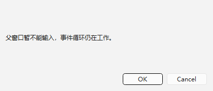
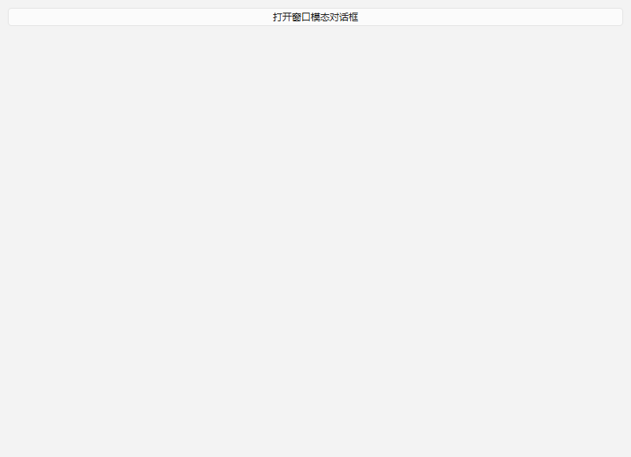

# 36 模态 非模态与对象生命期

这是独立可运行的 Qt Creator Widgets 项目，按统一模板组织。打开 [36_dialog.pro](36_dialog.pro)，选择 Kit 后构建运行。

## 阅读顺序

1. [mainwindow.ui](mainwindow.ui)：双击进入设计模式，先观察控件与布局。
2. [mainwindow.h](mainwindow.h)：窗口类、ui 指针和成员声明。
3. [mainwindow.cpp](mainwindow.cpp)：setupUi、连接与本步逻辑。
4. [main.cpp](main.cpp)：只负责启动窗口与事件循环。

## 在 Designer 中重做界面

从空白 Widgets 模板开始时，按下表拖入控件并设置相同的 objectName。已有完整 .ui 可直接使用；geometry 只适用于没有布局管理的控件。

### dialog.ui

| objectName | 类型 | 主要设置 |
|---|---|---|
| `Dialog` | QDialog | geometry=(0,0,420,180) |
| `hintLabel` | QLabel | text=父窗口暂不能输入，事件循环仍在工作。 |
| `buttonBox` | QDialogButtonBox | 按 .ui 中的默认属性 |
| `verticalLayout` | QVBoxLayout | 布局内的控件交给布局分配空间 |

Designer 信号槽连接：buttonBox.accepted() → Dialog.accept()；buttonBox.rejected() → Dialog.reject()。

### mainwindow.ui

| objectName | 类型 | 主要设置 |
|---|---|---|
| `MainWindow` | QMainWindow | geometry=(0,0,800,580) |
| `centralwidget` | QWidget | 按 .ui 中的默认属性 |
| `run` | QPushButton | text=打开窗口模态对话框 |
| `verticalLayout` | QVBoxLayout | 布局内的控件交给布局分配空间 |

## 完整文件

- [36_dialog.pro](36_dialog.pro)
- [dialog.cpp](dialog.cpp)
- [dialog.h](dialog.h)
- [dialog.ui](dialog.ui)
- [main.cpp](main.cpp)
- [mainwindow.cpp](mainwindow.cpp)
- [mainwindow.h](mainwindow.h)
- [mainwindow.ui](mainwindow.ui)
- [verify.h](verify.h)

verify.h 仅在传入 --verify 时执行运行检查，正常学习可以先忽略。

[统一模板说明](../../docs/project-format.md) · [安装与运行](../../docs/getting-started.md)
