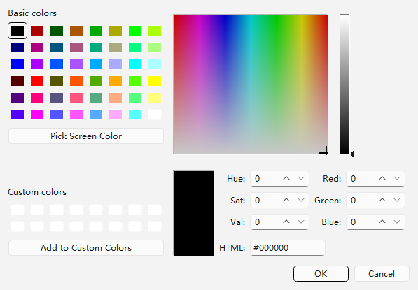
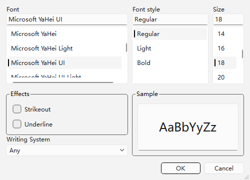
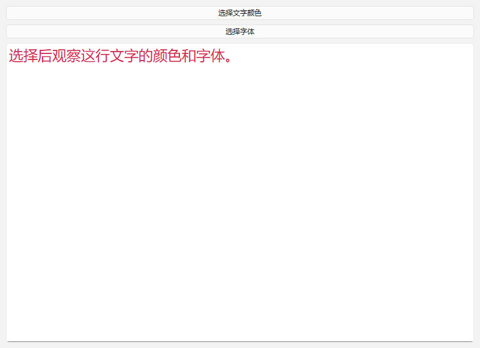

# 38 选择颜色与字体

[阅读讲解](../../docs/chapters/27-color_font.md) · [构建说明](../../docs/getting-started.md)

使用 Qt Creator 打开 `38_color_font.pro`，选择匹配的 Qt 6 Kit 构建运行；或从仓库根目录用 CMake 构建 `38_color_font` 目标。

本步目录内的源文件、头文件、资源和 `.ui` 是一个整体。`verify.h`（如有）用于可选自动检查，普通运行不会自动点击按钮。

