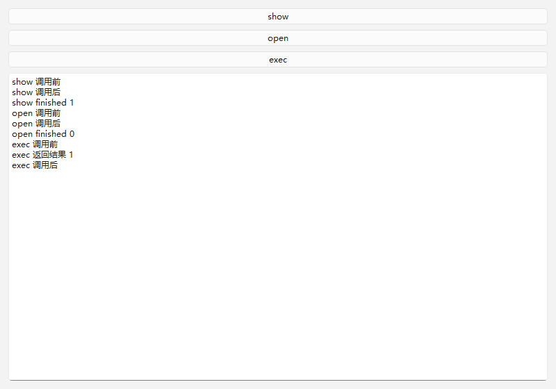

# 50 show open exec 三种调用对比

这是独立可运行的 Qt Creator Widgets 项目，按统一模板组织。打开 [50_dialog_modes.pro](50_dialog_modes.pro)，选择 Kit 后构建运行。

## 阅读顺序

1. [widget.ui](widget.ui)：双击进入设计模式，先观察控件与布局。
2. [widget.h](widget.h)：窗口类、ui 指针和成员声明。
3. [widget.cpp](widget.cpp)：setupUi、连接与本步逻辑。
4. [main.cpp](main.cpp)：只负责启动窗口与事件循环。

## 在 Designer 中重做界面

从空白 Widgets 模板开始时，按下表拖入控件并设置相同的 objectName。已有完整 .ui 可直接使用；geometry 只适用于没有布局管理的控件。

### dialog.ui

| objectName | 类型 | 主要设置 |
|---|---|---|
| `Dialog` | QDialog | geometry=(0,0,420,180) |
| `hintLabel` | QLabel | text=父窗口暂不能输入，事件循环仍在工作。 |
| `buttonBox` | QDialogButtonBox | 按 .ui 中的默认属性 |
| `verticalLayout` | QVBoxLayout | 布局内的控件交给布局分配空间 |

Designer 信号槽连接：buttonBox.accepted() → Dialog.accept()；buttonBox.rejected() → Dialog.reject()。

### widget.ui

| objectName | 类型 | 主要设置 |
|---|---|---|
| `Widget` | QWidget | geometry=(0,0,800,560) |
| `show` | QPushButton | text=show |
| `open` | QPushButton | text=open |
| `exec` | QPushButton | text=exec |
| `logEdit` | QPlainTextEdit | readOnly=true |
| `verticalLayout` | QVBoxLayout | 布局内的控件交给布局分配空间 |

## 完整文件

- [50_dialog_modes.pro](50_dialog_modes.pro)
- [dialog.cpp](dialog.cpp)
- [dialog.h](dialog.h)
- [dialog.ui](dialog.ui)
- [main.cpp](main.cpp)
- [verify.h](verify.h)
- [widget.cpp](widget.cpp)
- [widget.h](widget.h)
- [widget.ui](widget.ui)

verify.h 仅在传入 --verify 时执行运行检查，正常学习可以先忽略。

[统一模板说明](../../docs/project-format.md) · [安装与运行](../../docs/getting-started.md)
